# Entity Relationships and Referential Integrity Specification

**Project:** Vehicle Rental Platform  
**Market:** Vijayawada, Andhra Pradesh  
**Status:** Database Design Freeze Candidate Baseline  
**Confirmed Physical Tables:** **48 Physical Tables** (46 Application-Domain Tables + 2 Infrastructure-Managed Tables) + **8 Future-Phase Tables** (56 Total Cataloged Entities)

---

## 1. Domain Modeling Principles & Foreign Key Integrity

To maintain strict relational integrity across all 46 application-domain tables, the platform enforces:

1. **Zero Unvalidated Polymorphic Foreign Keys:**  
   Every business relationship (Vehicles, Bookings, Agreements, Custody Handovers, Inspections, Incidents, Deposits, Demands, Submissions, Rental Refunds, Payables) is bound via explicit, typed relational foreign keys with database constraints (`FOREIGN KEY REFERENCES`).
   - In `vehicle_custody_events`, custodians are explicitly typed via `from_custodian_user_id` / `from_partner_hub_id` and `to_custodian_user_id` / `to_partner_hub_id`.
   - In `rental_payment_submissions`, submissions explicitly reference `rental_payment_demands.id`, `manager_partner_id`, and `customer_user_id`.
   - In `rental_fee_refunds`, refunds explicitly reference `bookings.id` (nullable), `rental_payment_demands.id` (nullable), `booking_holds.id` (nullable), `manager_partner_id`, `customer_user_id`, and `recorded_by_user_id`.
2. **Strict Separation of Legal Ownership, Operational Management, and Custody:**
   - **Individual Legal Owner (`legal_owner_user_id`):** References `users.id` (individual citizen named on the vehicle RC).
   - **Partner Business Legal Owner (`legal_owner_partner_id`):** References `partner_profiles.id` (commercial business entity owning the fleet asset).
   - **Operational Manager (`manager_partner_id`):** References `partner_profiles.id` (authorized commercial partner operating the rental listing).
   - **Physical Custody (`vehicle_custody_events`):** Independent physical custody ledger tracking who possesses the vehicle across all 8 canonical permutations.
3. **Pessimistic Concurrency, Hold Isolation & Verification Locking:**
   - `booking_holds` reserves calendar intervals under `SELECT ... FOR UPDATE` row locks.
   - Creating a hold does **not** insert an incomplete record into `bookings`.
   - When a customer submits payment proof before hold expiration, the hold transitions to `VERIFICATION_PENDING`, extending the lock for the partner verification window.
   - `bookings` master rows are created only upon verified partner confirmation (or authorized pay-at-pickup policy).
4. **Partner-Direct Payment Collection & Zero Platform Cash:**
   - Rental charges and security deposits are collected directly by the managing partner via the partner's verified UPI QR/ID/Link or cash-at-pickup.
   - The platform never collects, holds, escrows, splits, or disburses customer rental funds or deposits in the MVP.
   - Platform general ledger accounts (`GATEWAY_CLEARING`, `CUSTOMER_REFUNDABLE_LIABILITY`, etc.) and automated payout tables are moved to Future Phase.
5. **Referential Deletion Controls:**
   - Dependent sub-assets (`vehicle_images`, `inspection_media`, `refresh_tokens`, `support_ticket_messages`) use `ON DELETE CASCADE`.
   - Core domain, contract, and audit entities (`vehicles`, `bookings`, `agreements`, `inspections`, `rental_payment_demands`, `rental_payment_submissions`, `rental_fee_refunds`, `security_deposits`, `security_deposit_refunds`, `contributor_payables`) strictly use `ON DELETE RESTRICT` to guarantee immutable audit trails.

---

## 2. Comprehensive Master Entity Relationship Diagram (46 MVP Domain Tables)

The following diagram explicitly models **all 46 application-domain tables** and their relational constraints.

```mermaid
erDiagram
    users ||--o{ user_roles : "grants"
    roles ||--o{ user_roles : "defines"
    users ||--o| customer_profiles : "has"
    users ||--o| contributor_profiles : "has"
    users ||--o| partner_profiles : "operates"
    partner_profiles ||--o{ partner_documents : "verifies_with"
    users ||--o{ kyc_verifications : "undergoes"
    users ||--o| driving_licences : "holds"
    users ||--o{ addresses : "registers"
    users ||--o{ refresh_tokens : "authenticates_with"

    cities ||--o{ addresses : "contains"
    cities ||--o{ partner_hubs : "hosts"
    partner_profiles ||--o{ partner_hubs : "operates_hub"
    addresses ||--o| partner_hubs : "hub_address"
    partner_hubs ||--o{ pickup_locations : "supplies_hub"
    addresses ||--o{ pickup_locations : "pickup_point_address"

    users ||--o{ vehicles : "owns_individually (legal_owner_user_id)"
    partner_profiles ||--o{ vehicles : "owns_as_business (legal_owner_partner_id)"
    partner_profiles ||--o{ vehicles : "manages_operationally (manager_partner_id)"
    partner_hubs ||--o{ vehicles : "stations_at (primary_hub_id)"
    vehicles ||--o{ vehicle_documents : "complies_with"
    vehicles ||--o{ vehicle_images : "showcases"
    vehicles ||--o{ vehicle_pricing_profiles : "schedules_rates"
    vehicles ||--o{ vehicle_features : "tagged_with"
    vehicles ||--o{ vehicle_maintenance_blocks : "blackouts"
    vehicles ||--o{ pickup_locations : "offers"

    vehicles ||--o{ vehicle_custody_events : "tracks_custody"
    addresses ||--o{ vehicle_custody_events : "handover_site"
    users ||--o{ vehicle_custody_events : "actor"
    users ||--o{ vehicle_custody_events : "authorized_representative"
    users ||--o{ vehicle_custody_events : "from_user_custodian"
    partner_hubs ||--o{ vehicle_custody_events : "from_hub_custodian"
    users ||--o{ vehicle_custody_events : "to_user_custodian"
    partner_hubs ||--o{ vehicle_custody_events : "to_hub_custodian"

    vehicles ||--o{ contributor_vehicle_applications : "applied_for"
    users ||--o{ contributor_vehicle_applications : "applies"
    partner_profiles ||--o{ contributor_vehicle_applications : "reviews"

    vehicles ||--o{ contribution_agreements : "contracted_under"
    users ||--o{ contribution_agreements : "contributor_party"
    partner_profiles ||--o{ contribution_agreements : "partner_party"
    contribution_agreements ||--o{ contribution_agreement_events : "audits"
    vehicles ||--o{ vehicle_withdrawal_requests : "requests_withdrawal"
    contribution_agreements ||--o{ vehicle_withdrawal_requests : "governed_by"
    users ||--o{ vehicle_withdrawal_requests : "initiated_by"

    vehicles ||--o{ booking_holds : "locks_interval"
    users ||--o{ booking_holds : "held_by_customer"
    booking_holds ||--o| bookings : "converts_to"

    vehicles ||--o{ bookings : "reserves"
    users ||--o{ bookings : "rents_as_customer"
    partner_profiles ||--o{ bookings : "manages_fulfillment"
    pickup_locations ||--o{ bookings : "pickup_point"
    pickup_locations ||--o{ bookings : "return_point"
    bookings ||--o{ booking_status_events : "status_history"
    bookings ||--o{ booking_extensions : "extends"
    bookings ||--o{ inspections : "condition_logged_by"
    vehicles ||--o{ inspections : "inspected"
    users ||--o{ inspections : "conducted_by"
    inspections ||--o{ inspection_media : "evidenced_by"
    bookings ||--o{ incidents : "damage_reported"
    vehicles ||--o{ incidents : "damage_sustained"
    users ||--o{ incidents : "reported_by"

    partner_profiles ||--|| partner_payment_profiles : "configures_direct_payee"
    booking_holds ||--o{ rental_payment_demands : "checkout_demand"
    bookings ||--o{ rental_payment_demands : "extension_or_invoice_demand"
    partner_profiles ||--o{ rental_payment_demands : "payee_partner"
    users ||--o{ rental_payment_demands : "demanded_from_customer"

    rental_payment_demands ||--o{ rental_payment_submissions : "submits_against"
    booking_holds ||--o{ rental_payment_submissions : "proof_for_hold"
    bookings ||--o{ rental_payment_submissions : "proof_for_booking"
    users ||--o{ rental_payment_submissions : "submitted_by_customer"
    partner_profiles ||--o{ rental_payment_submissions : "verifying_partner"
    users ||--o{ rental_payment_submissions : "verified_by_user"

    bookings ||--o{ rental_fee_refunds : "booking_fee_refund"
    rental_payment_demands ||--o{ rental_fee_refunds : "demand_refund"
    booking_holds ||--o{ rental_fee_refunds : "expired_hold_refund"
    partner_profiles ||--o{ rental_fee_refunds : "refunded_by_partner"
    users ||--o{ rental_fee_refunds : "refunded_to_customer"
    users ||--o{ rental_fee_refunds : "recorded_by"
    users ||--o{ rental_fee_refunds : "admin_arbitration"

    bookings ||--|| security_deposits : "secured_by"
    partner_profiles ||--o{ security_deposits : "held_by_partner"
    users ||--o{ security_deposits : "deposited_by_customer"
    security_deposits ||--o{ deposit_deductions : "claims"
    incidents ||--o{ deposit_deductions : "causes"
    users ||--o{ deposit_deductions : "proposed_by"
    users ||--o{ deposit_deductions : "resolved_by_admin"

    security_deposits ||--o{ security_deposit_refunds : "releases_via"
    bookings ||--o{ security_deposit_refunds : "booking_deposit_refund"
    partner_profiles ||--o{ security_deposit_refunds : "refunded_by_partner"
    users ||--o{ security_deposit_refunds : "refunded_to_customer"

    bookings ||--o| contributor_payables : "obligates_partner"
    contribution_agreements ||--o{ contributor_payables : "terms_set_by"
    users ||--o{ contributor_payables : "owed_to_contributor"
    partner_profiles ||--o{ contributor_payables : "debtor_partner"

    bookings ||--o| reviews : "rated_by"
    users ||--o{ reviews : "reviewer"
    vehicles ||--o{ reviews : "reviewed_vehicle"
    partner_profiles ||--o{ reviews : "reviewed_partner"

    users ||--o{ support_tickets : "opened_by"
    bookings ||--o{ support_tickets : "disputes_booking"
    vehicles ||--o{ support_tickets : "disputes_vehicle"
    users ||--o{ support_tickets : "assigned_admin"
    support_tickets ||--o{ support_ticket_messages : "messages"
    users ||--o{ support_ticket_messages : "message_sender"

    users ||--o{ notifications : "receives"
    users ||--o{ audit_logs : "actor_audit"
    outbox_events ||--o{ bookings : "delivers_integration_events"
```

---

## 3. Comprehensive Referential Integrity Matrix (All 46 MVP Domain Tables)

| # | Entity Name | Primary Relational Parent(s) (FK) | Child Entities (Referenced By) | Cardinality & Deletion Rules |
|---|---|---|---|---|
| 1 | `users` | None | `user_roles`, `customer_profiles`, `partner_profiles`, `contributor_profiles`, `kyc_verifications`, `driving_licences`, `addresses`, `refresh_tokens`, `vehicles` (individual owner), `bookings`, `inspections`, `rental_payment_submissions`, `rental_fee_refunds`, `security_deposits`, `security_deposit_refunds`, `contributor_payables`, `reviews`, `support_tickets`, `notifications`, `audit_logs`, `vehicle_custody_events` | 1-to-N (`CASCADE` for tokens/addresses; `RESTRICT` for operational/contract entities) |
| 2 | `roles` | None | `user_roles` | 1-to-N (`ON DELETE RESTRICT`) |
| 3 | `user_roles` | `users`, `roles` | None | N-to-1 (`CASCADE` on user, `RESTRICT` on role) |
| 4 | `refresh_tokens` | `users` | None | N-to-1 (`CASCADE` on user) |
| 5 | `addresses` | `cities`, `users` (nullable) | `customer_profiles`, `partner_hubs`, `pickup_locations`, `vehicle_custody_events` | 1-to-N (`RESTRICT` on cities/hubs/locations) |
| 6 | `customer_profiles`| `users`, `addresses` | None | 1-to-1 with `users` (`CASCADE`) |
| 7 | `partner_profiles` | `users` | `partner_documents`, `partner_payment_profiles`, `partner_hubs`, `vehicles` (as business owner & manager), `contribution_agreements`, `bookings`, `rental_payment_demands`, `rental_payment_submissions`, `rental_fee_refunds`, `security_deposits`, `security_deposit_refunds`, `contributor_payables` | 1-to-1 with `users` (`RESTRICT`) |
| 8 | `partner_documents`| `partner_profiles` | None | N-to-1 (`CASCADE` on partner) |
| 9 | `contributor_profiles`| `users` | None | 1-to-1 with `users` (`CASCADE`) |
| 10| `driving_licences` | `users` | None | 1-to-1 with `users` (`CASCADE`) |
| 11| `kyc_verifications`| `users` | None | N-to-1 (`CASCADE` on user) |
| 12| `cities` | None | `addresses`, `partner_hubs` | 1-to-N (`RESTRICT`) |
| 13| `partner_hubs` | `partner_profiles`, `addresses`, `cities` | `vehicles`, `pickup_locations`, `vehicle_custody_events` | N-to-1 (`RESTRICT`) |
| 14| `pickup_locations` | `vehicles`, `partner_hubs` (null), `addresses` (null) | `bookings` (as pickup / return point) | N-to-1 (`CASCADE` on vehicle, `RESTRICT` on bookings) |
| 15| `vehicles` | `users` (individual owner), `partner_profiles` (business owner), `partner_profiles` (manager), `partner_hubs` (hub) | `vehicle_documents`, `vehicle_images`, `vehicle_pricing_profiles`, `vehicle_features`, `pickup_locations`, `vehicle_maintenance_blocks`, `vehicle_custody_events`, `contribution_agreements`, `booking_holds`, `bookings`, `inspections`, `incidents`, `reviews` | N-to-1 (`RESTRICT` on core parents; `CASCADE` on images/pricing/features) |
| 16| `vehicle_documents`| `vehicles` | None | N-to-1 (`CASCADE` on vehicle) |
| 17| `vehicle_pricing_profiles` | `vehicles` | None | N-to-1 (`CASCADE` on vehicle) |
| 18| `vehicle_images` | `vehicles` | None | N-to-1 (`CASCADE` on vehicle) |
| 19| `vehicle_features` | `vehicles` | None | N-to-1 (`CASCADE` on vehicle) |
| 20| `vehicle_maintenance_blocks`| `vehicles`, `users` | None | N-to-1 (`CASCADE` on vehicle) |
| 21| `vehicle_custody_events`| `vehicles`, `bookings` (null), `inspections` (null), `addresses`, `users` (actor, rep, custodians), `partner_hubs` (hub custodians) | None | N-to-1 (`RESTRICT` on all explicit foreign keys) |
| 22| `contributor_vehicle_applications`| `vehicles`, `users`, `partner_profiles` (null) | None | N-to-1 (`RESTRICT`) |
| 23| `contribution_agreements`| `vehicles`, `users`, `partner_profiles` | `contribution_agreement_events`, `vehicle_withdrawal_requests`, `contributor_payables` | N-to-1 (`RESTRICT`) |
| 24| `contribution_agreement_events`| `contribution_agreements`, `users` | None | N-to-1 (`CASCADE` on agreement) |
| 25| `vehicle_withdrawal_requests`| `vehicles`, `contribution_agreements`, `users` | None | N-to-1 (`RESTRICT`) |
| 26| `booking_holds` | `vehicles`, `users` | `bookings` (optional convert link), `rental_payment_demands`, `rental_payment_submissions`, `rental_fee_refunds` | N-to-1 (`RESTRICT`) |
| 27| `bookings` | `vehicles`, `booking_holds` (null), `users`, `partner_profiles`, `pickup_locations` | `booking_status_events`, `booking_extensions`, `inspections`, `incidents`, `rental_fee_refunds`, `security_deposits`, `rental_payment_demands`, `rental_payment_submissions`, `security_deposit_refunds`, `contributor_payables`, `reviews`, `support_tickets` | N-to-1 (`RESTRICT`) |
| 28| `booking_status_events`| `bookings`, `users` (null) | None | N-to-1 (`CASCADE` on booking) |
| 29| `booking_extensions`| `bookings`, `users` (null) | None | N-to-1 (`RESTRICT`) |
| 30| `inspections` | `bookings` (null), `vehicles`, `users` | `inspection_media`, `vehicle_custody_events` | N-to-1 (`RESTRICT`) |
| 31| `inspection_media`| `inspections` | None | N-to-1 (`CASCADE` on inspection) |
| 32| `incidents` | `bookings`, `vehicles`, `users` | `deposit_deductions` | N-to-1 (`RESTRICT`) |
| 33| `partner_payment_profiles` | `partner_profiles` | None | 1-to-1 with `partner_profiles` (`CASCADE`) |
| 34| `rental_payment_demands` | `booking_holds` (null), `bookings` (null), `partner_profiles`, `users` | `rental_payment_submissions`, `rental_fee_refunds` | N-to-1 (`RESTRICT`) |
| 35| `rental_payment_submissions`| `rental_payment_demands`, `booking_holds` (null), `bookings` (null), `users`, `partner_profiles` | None | N-to-1 (`RESTRICT`) |
| 36| `rental_fee_refunds` | `bookings` (null), `rental_payment_demands` (null), `booking_holds` (null), `partner_profiles`, `users` (customer), `users` (recorded_by), `users` (admin, null) | None | N-to-1 (`RESTRICT` on all explicit foreign keys) |
| 37| `security_deposits`| `bookings`, `partner_profiles`, `users` | `deposit_deductions`, `security_deposit_refunds` | 1-to-1 with `bookings` (`RESTRICT`) |
| 38| `deposit_deductions`| `security_deposits`, `incidents` (null), `users` (null) | None | N-to-1 (`RESTRICT`) |
| 39| `security_deposit_refunds` | `security_deposits`, `bookings`, `partner_profiles`, `users` | None | N-to-1 (`RESTRICT`) |
| 40| `contributor_payables`| `bookings`, `contribution_agreements`, `users`, `partner_profiles` | None | 1-to-1 with `bookings` (`RESTRICT`) |
| 41| `outbox_events` | Typed aggregate references (`bookings`, `demands`, `submissions`) | None | Append-only integration queue (Zero FKs) |
| 42| `reviews` | `bookings`, `users`, `vehicles`, `partner_profiles` | None | 1-to-1 with `bookings` (`RESTRICT`) |
| 43| `support_tickets`| `users`, `bookings` (null), `vehicles` (null), `users` (admin) | `support_ticket_messages` | N-to-1 (`RESTRICT`) |
| 44| `support_ticket_messages`| `support_tickets`, `users` | None | N-to-1 (`CASCADE` on ticket) |
| 45| `notifications` | `users` | None | N-to-1 (`CASCADE` on user) |
| 46| `audit_logs` | `users` (actor, null) | None | Append-only security audit log |

---

## 4. Infrastructure Tables (Framework-Managed)

The 2 physical tables in the confirmed 48-table physical count are strictly framework-managed:
- **`shedlock`**: Managed directly by the ShedLock Spring library (`name` PK, `lock_until`, `locked_at`, `locked_by`).
- **`flyway_schema_history`**: Managed directly by Flyway migration engine (`installed_rank` PK, `version`, `script`, `checksum`, `success`).
Neither table participates in application-domain relational foreign keys.

---

## 5. Future-Phase Marketplace Gateway & Double-Entry Tables (8 Tables)

The 8 future-phase tables (`payment_webhook_events`, `partner_commissions`, `payout_methods`, `settlements`, `ledger_accounts`, `ledger_transactions`, `ledger_entries`, `platform_commission_rules`) will participate in relationships as defined in [FINAL_ENTITY_INVENTORY.md](file:///d:/vehicle-rental-platform/docs/FINAL_ENTITY_INVENTORY.md#3-future-phase-marketplace-gateway--double-entry-tables-8-tables) upon provider activation.
