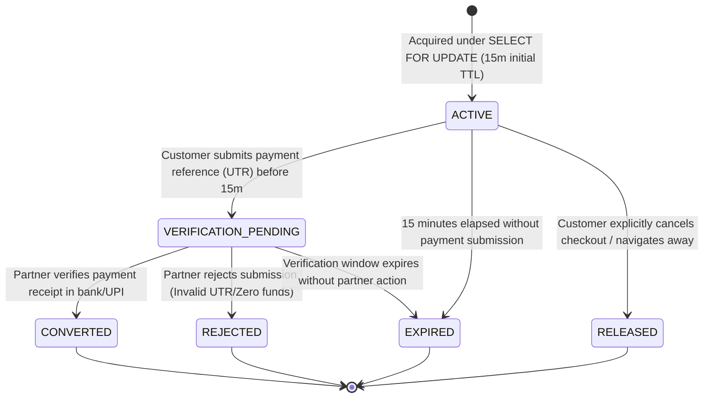
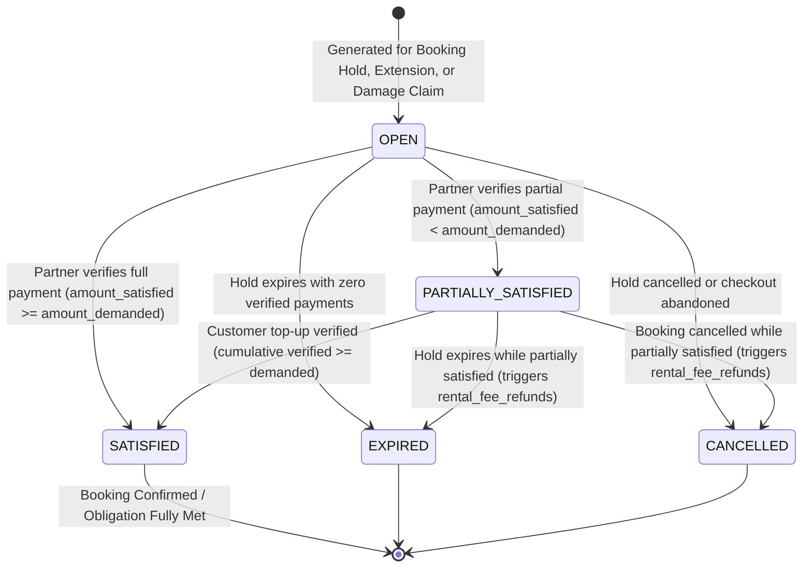
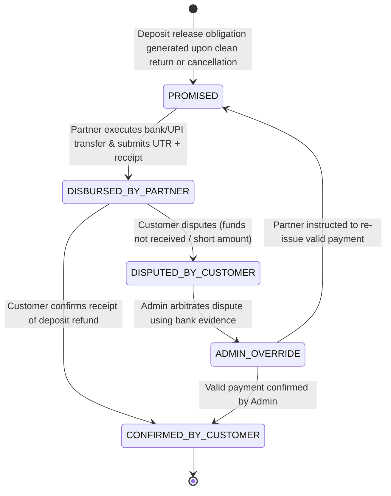
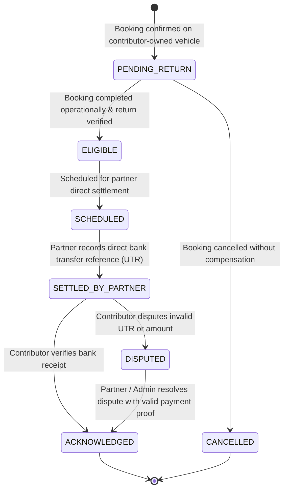

# State Machines Specification: Operational & Financial Decoupling

**Project:** Vehicle Rental Platform  
**Market:** Vijayawada, Andhra Pradesh  
**Status:** Database Design Freeze Candidate Baseline (Partner-Direct Payment Model)  
**Critical Principle:** **Operational completion is strictly decoupled from financial settlement.** A booking reaches operational completion (`COMPLETED`) when the vehicle is returned and inspected, regardless of whether deposit refunds, damage disputes, or contributor settlements remain pending, disputed, or in progress.

---

## 1. Booking Hold State Machine (Independent Reservation Lock & Verification Window)

A booking hold is a temporary slot reservation. **Creating a booking hold does NOT create an incomplete or draft record in the `bookings` table.** The `bookings` master table only receives confirmed bookings resulting from verified partner payment confirmation (or an authorized pay-at-pickup policy).



### Transition Specifications:

| From Status | To Status | Allowed Actor | Trigger / Condition | Concurrency & Database Actions | Failure Handling |
|---|---|---|---|---|---|
| `[*]` | `ACTIVE` | `CUSTOMER` | Customer clicks "Proceed to Checkout" | `SELECT id FROM vehicles WHERE id = :id FOR UPDATE;` checks for overlapping active holds, bookings, and buffers. Inserts `booking_holds` with `expires_at = NOW() + 15 MIN`. Generates initial `rental_payment_demands`. | Returns `409 Conflict` if vehicle is already locked or booked for the interval. |
| `ACTIVE` | `VERIFICATION_PENDING` | `CUSTOMER` | Customer submits direct payment proof (UTR / receipt) before initial TTL | Extends `booking_holds.expires_at = NOW() + verification_window_minutes` (e.g. 60m). Status becomes `VERIFICATION_PENDING`. Preserves inventory lock while partner verifies. | Rejects submission if hold is already expired or cancelled. |
| `VERIFICATION_PENDING` | `CONVERTED` | `RENTAL_PARTNER` | Partner independently checks bank/UPI statement and clicks "Verify Payment" | Status transitions to `CONVERTED`. Inserts new record into `bookings` (`booking_status = CONFIRMED`). Generates initial `security_deposits` record (`PENDING_COLLECTION` or `COLLECTED_HELD_BY_PARTNER`). | Concurrency check guarantees hold has not expired or already been converted. |
| `VERIFICATION_PENDING` | `REJECTED` | `RENTAL_PARTNER` | Partner rejects submission (fake UTR, no funds credited, wrong payee) | Marks submission `REJECTED`. Sets `booking_holds.status = REJECTED`. Frees vehicle calendar immediately. Customer notified with rejection reason. | Customer may restart checkout if inventory remains unreserved. |
| `ACTIVE` | `EXPIRED` | `SYSTEM` (Scheduler) | Background task runs: `NOW() > expires_at` without submission | Marks `booking_holds.status = EXPIRED`. Vehicle slot becomes immediately available for other customers. | Idempotent background task. |
| `VERIFICATION_PENDING` | `EXPIRED` | `SYSTEM` (Scheduler) | Partner fails to verify within 60-min window (`NOW() > expires_at`) | Marks `booking_holds.status = EXPIRED`. Frees inventory to avoid indefinite lock. Initiates partner non-response exception alert. | Late or unmatched payments handled via explicit partner exception/refund workflow (see Section 3.3). |
| `ACTIVE` | `RELEASED` | `CUSTOMER` | Customer clicks "Cancel Checkout" or abandons session | Marks `booking_holds.status = RELEASED`. Frees vehicle calendar immediately. | Graceful release without calendar blocking. |

---

## 2. Booking Operational State Machine

The master booking lifecycle represents the physical rental contract. It is created directly in `CONFIRMED` upon verified partner payment confirmation (or under an authorized pay-at-pickup policy).


### 2.1 Complete Transition Specifications:

| From Status | To Status | Allowed Actor | Trigger / Precondition | State Actions & Side Effects | Financial & Record Effects |
|---|---|---|---|---|---|
| `[*]` | `CONFIRMED` | `RENTAL_PARTNER` / `SYSTEM` | Payment submission marked `VERIFIED` by partner (or partner pay-at-pickup policy) | Inserts `bookings` record; logs `booking_status_events`; notifies customer and partner. | Records verified rental payment submission. Initializes `security_deposits` record in partner custody. Zero platform cash movement. |
| `CONFIRMED` | `READY_FOR_PICKUP` | `RENTAL_PARTNER` / `VEHICLE_CONTRIBUTOR` | Vehicle cleaned, staged at hub/address, and pre-rental checklist initiated | Sets `booking_status = READY_FOR_PICKUP`; customer receives pickup readiness notification. | Operational update; checks whether deposit collection is pending before key handover. |
| `CONFIRMED` | `IN_PROGRESS` | `PARTNER` / `CONTRIBUTOR` + `CUSTOMER` | Direct vehicle handover without staging state; dual inspection completed | **Handover Invariant:** Blocked until required rental amount and security deposit are confirmed collected. Sets `booking_status = IN_PROGRESS`; records `inspections` (PRE_RENTAL); logs `vehicle_custody_events`. | Partner records security deposit collection reference if collected in cash at handover. |
| `CONFIRMED` | `CANCELLED` | `CUSTOMER` / `PARTNER` / `ADMIN` | Cancellation request prior to vehicle handover | Sets `booking_status = CANCELLED`, sets `cancelled_at` and `cancellation_reason`; frees vehicle calendar immediately. | Generates partner rental refund obligation in `rental_fee_refunds` per configurable cancellation policy snapshot; 100% security deposit marked for partner refund in `security_deposit_refunds`. |
| `CONFIRMED` | `NO_SHOW` | `RENTAL_PARTNER` / `ADMIN` | Customer fails to arrive within 2 hours of scheduled start time | Sets `booking_status = NO_SHOW`; frees vehicle calendar; alerts customer of no-show forfeiture. | Rental subtotal retained by partner per cancellation policy; 100% security deposit refunded by partner via `security_deposit_refunds`. |
| `READY_FOR_PICKUP` | `IN_PROGRESS` | `PARTNER` / `CONTRIBUTOR` + `CUSTOMER` | Pickup inspection signed and digital OTP verified | **Handover Invariant:** Vehicle handover blocked until required payment and deposit verified. Sets `booking_status = IN_PROGRESS`; logs custody handover. | Deposit confirmed in partner custody. |
| `READY_FOR_PICKUP` | `CANCELLED` | `PARTNER` / `ADMIN` | Vehicle breakdown, inspection failure, or customer emergency prior to key handover | Sets `booking_status = CANCELLED`; logs incident; frees vehicle calendar. | Full 100% rental refund assigned to partner in `rental_fee_refunds`; 100% deposit refund assigned in `security_deposit_refunds`. |
| `READY_FOR_PICKUP` | `NO_SHOW` | `RENTAL_PARTNER` / `ADMIN` | Customer fails to claim vehicle within 2 hours of start | Sets `booking_status = NO_SHOW`; frees vehicle calendar. | Rental amount retained per policy; 100% security deposit refunded by partner via `security_deposit_refunds`. |
| `IN_PROGRESS` | `OVERDUE` | `SYSTEM` (Scheduled) | Current time exceeds `ends_at` + 30-min buffer without extension | Sets `booking_status = OVERDUE`; alerts fleet manager, customer, and support; initiates penalty tracking. | Accrues hourly late fee penalty to be claimed by partner against security deposit. |
| `IN_PROGRESS` | `RETURNED` | `PARTNER` / `CONTRIBUTOR` + `CUSTOMER` | Vehicle returned on time/early; physical return inspection executed | Sets `booking_status = RETURNED`; records `inspections` (POST_RENTAL); logs `vehicle_custody_events` (handover back to partner/owner). | Initiates deposit return evaluation in `security_deposits`. |
| `OVERDUE` | `RETURNED` | `PARTNER` / `CONTRIBUTOR` + `CUSTOMER` | Overdue vehicle returned; physical return inspection executed | Sets `booking_status = RETURNED`; logs `vehicle_custody_events`; attaches late penalty calculation. | Partner logs deposit deduction proposal for overdue charges. |
| `RETURNED` | `COMPLETED` | `RENTAL_PARTNER` / `SYSTEM` | Operational return signed off; vehicle inspected and released for next rental | Sets `booking_status = COMPLETED`. Triggers contributor payable eligibility in `contributor_payables`. | Financial settlement runs independently; does not block operational completion. |

### 2.2 Disallowed Transitions & Terminal Invariants:
- **Terminal States:** `COMPLETED`, `CANCELLED`, and `NO_SHOW` are **strictly terminal**. No transitions out of these states are permitted under any circumstances.
- **In-Custody Protections:** A booking in `IN_PROGRESS` or `OVERDUE` **cannot be cancelled or marked as no-show**. It must physically terminate via `RETURNED`.
- **Operational Decoupling:** Failed or disputed deposit refunds, damage claim arbitrations, or contributor payouts **never revert a `COMPLETED`, `CANCELLED`, or `NO_SHOW` booking**.

---

## 3. Rental Payment Demand & Submission State Machines (Decoupled Lifecycles)

In the Partner-Direct model, customer payments flow directly to the managing partner's external UPI QR, UPI ID, payment link, or cash at pickup. The platform decouples the financial demand (what the customer owes) from individual payment submissions (customer transfer attempts and proof).

### 3.1 Rental Payment Demand Lifecycle (`rental_payment_demands`)

The payment demand represents the total financial amount owed by the customer for an active reservation hold, extension, or damage invoice.



### 3.2 Customer Payment Submission Lifecycle (`rental_payment_submissions`)

The payment submission represents an individual external transfer or cash transaction submitted by the customer against an open demand.

```mermaid
stateDiagram-v2
    [*] --> SUBMITTED_FOR_VERIFICATION: Customer transfers money & inputs UTR + receipt proof
    
    SUBMITTED_FOR_VERIFICATION --> VERIFIED: Partner independently verifies bank/UPI credit
    SUBMITTED_FOR_VERIFICATION --> REJECTED: Partner finds no credit / invalid UTR / wrong amount
    
    VERIFIED --> [*]: Verified amount accumulates into demand.amount_satisfied
    REJECTED --> [*]: Rejection logged; customer alerted; may submit top-up or correction
```

### 3.3 State Transition Specifications & Accumulation Rules

| Entity | From Status | To Status | Allowed Actor | Trigger / Condition | Concurrency & Validation Rules | Side Effects |
|---|---|---|---|---|---|---|
| `rental_payment_demands` | `[*]` | `OPEN` | `SYSTEM` | Hold created, extension requested, or damage invoice issued | Created under vehicle row lock with `amount_demanded` and `amount_satisfied = 0.00`. | Associates with `booking_holds` or `bookings`. |
| `rental_payment_submissions` | `[*]` | `SUBMITTED_FOR_VERIFICATION` | `CUSTOMER` | Customer transfers money to partner and submits UTR | 1. Verifies parent demand is in `OPEN` or `PARTIALLY_SATISFIED`.<br>2. Verifies hold has not reached `EXPIRED`.<br>3. Enforces unique constraint on `(manager_partner_id, transaction_reference)` to prevent UTR reuse.<br>4. Stores timestamp, amount, payment method, and optional receipt object key. | Transitions hold to `VERIFICATION_PENDING`; extends lock by verification window (e.g. 60m). Dispatches alert to managing partner. |
| `rental_payment_submissions` | `SUBMITTED_FOR_VERIFICATION` | `VERIFIED` | `RENTAL_PARTNER` | Partner inspects bank/UPI statement and verifies credit of funds | 1. **Strict Partner Auth:** ONLY authenticated users of managing partner organization can verify.<br>2. **Anti-Auto-Verification Invariant:** Customer upload NEVER auto-verifies; only explicit partner API action marks `VERIFIED`. | 1. Sets `submissions.status = VERIFIED`.<br>2. Accumulates `demands.amount_satisfied += submission.amount_submitted`.<br>3. Evaluates demand satisfaction rules (see below). |
| `rental_payment_submissions` | `SUBMITTED_FOR_VERIFICATION` | `REJECTED` | `RENTAL_PARTNER` | Partner finds no incoming credit, invalid UTR, or payment declined | Partner supplies mandatory `rejection_reason` (`UTR_NOT_FOUND`, `AMOUNT_MISMATCH`, `PAYMENT_DECLINED`). | Sets `submissions.status = REJECTED`. Demand remains in `OPEN` or `PARTIALLY_SATISFIED`. Customer alerted to submit corrected UTR if hold window remains. |
| `rental_payment_demands` | `OPEN` or `PARTIALLY_SATISFIED` | `PARTIALLY_SATISFIED` | `SYSTEM` (Internal) | Submission verified, but `amount_satisfied < amount_demanded` | Atomic increment on `amount_satisfied`. | Sets `demands.status = PARTIALLY_SATISFIED`. Customer receives notification indicating outstanding balance and is prompted to submit a top-up payment. |
| `rental_payment_demands` | `OPEN` or `PARTIALLY_SATISFIED` | `SATISFIED` | `SYSTEM` (Internal) | Submission verified and `amount_satisfied >= amount_demanded` | Atomic increment on `amount_satisfied`. | 1. Sets `demands.status = SATISFIED`.<br>2. If `amount_satisfied > amount_demanded` (overpayment), automatically generates an overpayment refund obligation in `rental_fee_refunds` for the excess amount.<br>3. Triggers **Booking Confirmation Invariant** evaluation. |
| `rental_payment_demands` | `OPEN` or `PARTIALLY_SATISFIED` | `EXPIRED` | `SYSTEM` (Scheduler) | Hold expires without full demand satisfaction | Checked by ShedLock scheduled task. | If `amount_satisfied > 0`, automatically enqueues partner refund obligation in `rental_fee_refunds` (`refund_reason = LATE_PAYMENT_EXPIRED_HOLD`). |

### 3.4 Multi-Submission, Partial Payments, Top-Ups & Edge Scenarios

1. **Partial Payments & Top-Ups Workflow:**
   - A demand is issued for ₹1,500 (`amount_demanded = 1500.00`, `amount_satisfied = 0.00`, `status = OPEN`).
   - Customer submits a first payment of ₹1,000 (`rental_payment_submissions` #1 created in `SUBMITTED_FOR_VERIFICATION`).
   - Partner verifies ₹1,000 in UPI/bank statement (`submission #1 = VERIFIED`).
   - Demand accumulates: `amount_satisfied = 1000.00`. Since ₹1,000 < ₹1,500, demand transitions to `PARTIALLY_SATISFIED`.
   - Customer receives an in-app alert that ₹500 remains outstanding.
   - Customer submits a second payment of ₹500 (`submission #2 = SUBMITTED_FOR_VERIFICATION`).
   - Partner verifies the second payment (`submission #2 = VERIFIED`).
   - Demand accumulates: `amount_satisfied = 1500.00`. Demand transitions to `SATISFIED`.
   - The booking confirmation invariant is satisfied; the hold converts to a `CONFIRMED` master booking.
2. **Handling Rejected Submissions:**
   - If the partner rejects submission #1 because the UTR was invalid, the submission moves to `REJECTED`.
   - `amount_satisfied` remains ₹0.00.
   - The demand remains `OPEN`. The customer may re-submit a valid UTR before the hold TTL expires.
3. **Overpayment Recording and Automated Refund Tracking:**
   - If a customer owes ₹1,500 but accidentally transfers ₹2,000, and the partner verifies the ₹2,000 credit:
   - The demand becomes `SATISFIED` (`amount_satisfied = 2000.00`).
   - The platform automatically inserts a `rental_fee_refunds` record:
     * `gross_amount_paid = 2000.00`
     * `amount_demanded = 1500.00`
     * `refund_amount = 500.00`
     * `refund_reason = OVERPAYMENT_RETURN`
     * `refund_status = PENDING_PARTNER_DISBURSEMENT`
   - The partner is obligated to return the excess ₹500 directly outside the platform and record the refund UTR.
4. **Duplicate UTR Prevention:**
   - Database constraint `uk_submissions_partner_ref` on `(manager_partner_id, transaction_reference)` prevents the same UTR from being submitted to the same partner twice across all bookings.
5. **Cash-at-Pickup Evidencing & Verification:**
   - If pay-at-pickup is authorized by the partner, the demand remains `OPEN` until pickup.
   - At vehicle handover, the customer pays cash. The partner enters the physical cash receipt voucher number and cash collection timestamp via `POST /api/v1/partner/payment-submissions`.
   - The partner immediately marks the submission `VERIFIED`. Handover inspection cannot complete until verification is logged.
6. **Booking Confirmation Invariant:**
   A booking can be confirmed ONLY when:
   - Vehicle calendar availability is valid under exclusive row lock (`SELECT ... FOR UPDATE`).
   - Applicable payment demands are `SATISFIED` through verified submissions, OR an explicit partner-approved pay-at-pickup policy permits the required unpaid balance.
   - Any required security-deposit policy is satisfied.
   - The hold is still valid or safely revalidated under the vehicle lock.
   - **An expired hold is NEVER silently converted to a confirmed booking.**
7. **Hold Expiry while Payment is Awaiting Verification / Late Payments:**
   - If the 60-minute verification window elapses while a submission is in `SUBMITTED_FOR_VERIFICATION`, the hold status transitions to `EXPIRED` to prevent indefinite calendar locking.
   - If the partner subsequently verifies the payment, the system acquires the vehicle row lock and checks calendar availability.
   - If the vehicle interval has been booked by another customer in the interim, the booking **cannot be confirmed**.
   - The platform creates an exception record in `rental_fee_refunds` referencing `hold_id` and `demand_id` with `booking_id = NULL` and `refund_reason = LATE_PAYMENT_EXPIRED_HOLD`.
   - The partner is legally and operationally bound to return 100% of the funds directly to the customer outside the platform.

---

## 4. Rental-Fee Refund State Machine (`rental_fee_refunds`)

Tracks direct rental-fee refunds executed by the rental partner outside the platform. Used for booking cancellations, overpayments, late-payment hold exceptions, service deficiencies, and dispute resolutions.

```mermaid
stateDiagram-v2
    [*] --> PENDING_PARTNER_DISBURSEMENT: Obligation generated (Cancellation / Overpayment / Expired Hold / Dispute)
    
    PENDING_PARTNER_DISBURSEMENT --> DISBURSED_BY_PARTNER: Partner executes external transfer (UPI/NEFT/IMPS) & enters UTR + receipt
    
    DISBURSED_BY_PARTNER --> CONFIRMED_BY_CUSTOMER: Customer confirms receipt in account OR 72h window elapses
    DISBURSED_BY_PARTNER --> DISPUTED_BY_CUSTOMER: Customer disputes within 72h (funds not received / short amount)
    
    DISPUTED_BY_CUSTOMER --> ADMIN_OVERRIDE: Admin arbitrates dispute using bank statements
    ADMIN_OVERRIDE --> CONFIRMED_BY_CUSTOMER: Admin confirms valid payment
    ADMIN_OVERRIDE --> PENDING_PARTNER_DISBURSEMENT: Admin rejects invalid UTR; partner instructed to re-issue
    
    CONFIRMED_BY_CUSTOMER --> [*]
```

### 4.1 Refund Transition Specifications:

| From Status | To Status | Allowed Actor | Trigger / Condition | Concurrency & Validation Rules | State Actions & Side Effects |
|---|---|---|---|---|---|
| `[*]` | `PENDING_PARTNER_DISBURSEMENT` | `SYSTEM` | Booking cancellation, overpayment verification, expired-hold payment verification, or Admin dispute decision | Calculates refundable rental fee from configurable business rules snapshot in `cancellation_policy_snapshot`. Explicit FKs to `partner_profiles`, `users`, and nullable `bookings`/`booking_holds`/`demands`. | Inserts `rental_fee_refunds` record; notifies managing partner of pending refund obligation with calculated amount. |
| `PENDING_PARTNER_DISBURSEMENT` | `DISBURSED_BY_PARTNER` | `RENTAL_PARTNER` | Partner executes external bank/UPI transfer to customer and submits UTR + receipt proof | 1. Mandatory `partner_transaction_reference` (UTR).<br>2. Mandatory `refund_method`.<br>3. Unique check on `(manager_partner_id, partner_transaction_reference)`.<br>4. **Non-Equivalence Invariant:** Partner UTR does NOT mean customer received funds. | Sets `refund_status = DISBURSED_BY_PARTNER`, `disbursed_at = NOW()`. Starts 72-hour customer confirmation/dispute window. Customer notified. |
| `DISBURSED_BY_PARTNER` | `CONFIRMED_BY_CUSTOMER` | `CUSTOMER` / `SYSTEM` | Customer clicks "Confirm Receipt" in UI, OR 72-hour window expires without dispute | Verifies 72 hours have elapsed or customer identity matches `customer_user_id`. | Sets `refund_status = CONFIRMED_BY_CUSTOMER`, `acknowledged_at = NOW()`. Obligation permanently closed. |
| `DISBURSED_BY_PARTNER` | `DISPUTED_BY_CUSTOMER` | `CUSTOMER` | Customer reports funds not credited or wrong amount within 72h | Requires customer to provide dispute reason and optional account statement. | Sets `refund_status = DISPUTED_BY_CUSTOMER`, `dispute_opened_at = NOW()`. Escalates to Admin dispute queue. |
| `DISPUTED_BY_CUSTOMER` | `ADMIN_OVERRIDE` | `ADMIN` | Admin reviews banking evidence from both partner and customer | Admin decision: If valid transfer proven $\rightarrow$ mark `CONFIRMED_BY_CUSTOMER`. If invalid/fake UTR $\rightarrow$ revert to `PENDING_PARTNER_DISBURSEMENT` with compliance warning. | Updates status and audit log; notifies customer and partner of formal arbitration outcome. |

---

## 5. Security Deposit Custody & Refund State Machine (`security_deposits`)

Security deposits are collected directly by the managing partner, held in partner custody, and refunded directly by the partner. **A disputed damage claim is NEVER automatically approved merely because a 48-hour response window expires.**

```mermaid
stateDiagram-v2
    [*] --> PENDING_COLLECTION: Initialized upon booking confirmation
    PENDING_COLLECTION --> COLLECTED_HELD_BY_PARTNER: Partner verifies deposit collection
    
    COLLECTED_HELD_BY_PARTNER --> FULLY_REFUNDED: 1. Clean return inspection OR 2. Pre-pickup cancellation
    COLLECTED_HELD_BY_PARTNER --> DEDUCTION_PROPOSED: Post-rental inspection logs damage/fuel/late fee
    
    DEDUCTION_PROPOSED --> DISPUTED: Customer challenges deduction within 48h
    DEDUCTION_PROPOSED --> PENDING_ADMIN_REVIEW: Customer does not respond within 48h
    
    DISPUTED --> ADMIN_ARBITRATION: Admin reviews photos, GPS logs, inspection reports
    PENDING_ADMIN_REVIEW --> ADMIN_ARBITRATION: Admin verifies partner evidence before approving
    
    ADMIN_ARBITRATION --> PARTIALLY_REFUNDED: Admin upholds partial deduction; partner refunds remainder
    ADMIN_ARBITRATION --> FULLY_REFUNDED: Admin rejects partner claim; partner refunds 100%
    ADMIN_ARBITRATION --> RETAINED_FOR_DAMAGE: Admin approves 100% deposit forfeiture for severe damage
    
    PARTIALLY_REFUNDED --> CLOSED: All refunds confirmed / balance ₹0
    FULLY_REFUNDED --> CLOSED: 100% refunded / balance ₹0
    RETAINED_FOR_DAMAGE --> CLOSED: 100% deducted / balance ₹0
    
    CLOSED --> [*]
```



### Review and Resolution Rules:
1. **Direct Partner Custody:** The partner is the physical and legal custodian of the security deposit funds. The platform records expected amount, collected reference, refund reference, and evidence.
2. **Immediate Release of Undisputed Balance:** If the deposit is ₹5,000 and the damage claim is ₹1,500, the uncontested ₹3,500 must be **immediately refunded** by the partner directly to the customer.
3. **48-Hour Customer Window:** The customer is notified of the proposed deduction and has 48 hours to either agree or dispute with counter-evidence.
4. **Disputed Claims:** Status moves to `DISPUTED` and enters `ADMIN_ARBITRATION`. Admin evaluates pre-rental vs. post-rental inspection media, GPS logs, and repair estimates. No deduction is approved without Admin review.
5. **Non-Responsive Claims:** If the customer does not respond within 48 hours, status moves to `PENDING_ADMIN_REVIEW`. An Admin must verify the partner's evidence before approving any deduction.

---

## 5. Security Deposit Direct Refund State Machine (`security_deposit_refunds`)

Tracks direct refund execution by the rental partner outside the platform. The platform records, monitors, and audits refunds, but does not execute external gateway transfers.



### Refund Transition Specifications:

| From Status | To Status | Allowed Actor | Trigger / Condition | State Actions & Evidence Rules |
|---|---|---|---|---|
| `[*] ` | `PROMISED` | `SYSTEM` / `PARTNER` | Clean return inspection completed or booking cancelled prior to pickup | Inserts `security_deposit_refunds` record; sets `refund_amount = undisputed_balance`. Notifies partner of pending refund obligation. |
| `PROMISED` | `DISBURSED_BY_PARTNER` | `RENTAL_PARTNER` | Partner transfers funds via UPI/NEFT to customer and enters UTR | Partner provides mandatory `refund_transaction_reference` (UTR), `refund_method`, and optional receipt upload. Sets `refunded_at = NOW()`. |
| `DISBURSED_BY_PARTNER` | `CONFIRMED_BY_CUSTOMER` | `CUSTOMER` / `SYSTEM` | Customer confirms receipt (or 72h auto-acknowledgement window expires without dispute) | Sets `status = CONFIRMED_BY_CUSTOMER`, `acknowledged_at = NOW()`. Updates parent `security_deposits.status = CLOSED`. |
| `DISBURSED_BY_PARTNER` | `DISPUTED_BY_CUSTOMER` | `CUSTOMER` | Customer reports funds not credited within 72h | Sets `status = DISPUTED_BY_CUSTOMER`. Customer provides bank statement showing non-receipt. Escalates to Admin Support. |
| `DISPUTED_BY_CUSTOMER` | `ADMIN_OVERRIDE` | `ADMIN` | Admin reviews bank statements from both partner and customer | If transfer was successful, Admin marks `CONFIRMED_BY_CUSTOMER`. If transfer failed or fake UTR was provided, Admin reverts to `PROMISED` and issues partner compliance warning. |

---

## 6. Vehicle Custody State Machine (Generic & Ownership-Independent)

Physical vehicle custody is modeled **independently of vehicle legal ownership and booking status**.

### Initial Custody Rules:
- **Partner-Owned Vehicles (`PARTNER_OWNED`):** Begin in `PARTNER_CUSTODY` upon verification and hub assignment.
- **Contributor-Owned Vehicles (`CONTRIBUTOR_OWNED`):** Begin in `CONTRIBUTOR_CUSTODY` upon registration; transition to `PARTNER_CUSTODY` upon hub onboarding, or remain in `CONTRIBUTOR_CUSTODY` for owner-managed handovers.


### The 8 Canonical Custody Permutations (`vehicle_custody_events`):
1. `CONTRIBUTOR_TO_PARTNER`: Contributor delivers vehicle to partner hub for fleet onboarding.
2. `PARTNER_TO_CUSTOMER`: Customer picks up vehicle at partner hub (partner-managed handover).
3. `CONTRIBUTOR_TO_CUSTOMER`: Customer picks up vehicle directly from contributor residence (**owner-managed direct handover**).
4. `CUSTOMER_TO_PARTNER`: Customer returns vehicle to partner hub (partner-managed return).
5. `CUSTOMER_TO_CONTRIBUTOR`: Customer returns vehicle directly to contributor residence (**owner-managed direct return**).
6. `PARTNER_TO_CONTRIBUTOR`: Partner returns vehicle to contributor upon agreement termination or withdrawal.
7. `INTER_HUB_TRANSFER`: Partner relocates vehicle between two operational depots in the city.
8. `LOGISTICS_RELOCATION`: Authorized representative / logistics driver handles doorstep delivery or recovery.

---

## 7. Contributor Payable & Settlement Lifecycle (Approach A Direct Settlement)

Tracks the partner's contractual obligation to the contributor. **The rental partner is the sole legal debtor.** The partner pays the contributor directly outside the platform. Direct payments are **never represented as platform cash disbursements**.



### Transition Specifications:

| From Status | To Status | Allowed Actor | Trigger / Condition | State Actions & Audit Rules |
|---|---|---|---|---|
| `[*] ` | `PENDING_RETURN` | `SYSTEM` | Contributor vehicle booking is confirmed | Inserts `contributor_payables` row with fixed fee from agreement terms. Single lump-sum model enforced. |
| `PENDING_RETURN` | `ELIGIBLE` | `SYSTEM` | Booking reaches `COMPLETED` operational status | Marks payable `ELIGIBLE`. Notifies partner that payment is due per agreement schedule. |
| `PENDING_RETURN` | `CANCELLED` | `SYSTEM` | Booking cancelled before completion | Sets `payable_status = CANCELLED` unless signed agreement contains `cancellation_compensation_rate`. |
| `ELIGIBLE` | `SCHEDULED` | `RENTAL_PARTNER` | Partner flags payable for immediate batch settlement | Sets `payable_status = SCHEDULED`. |
| `SCHEDULED` | `SETTLED_BY_PARTNER` | `RENTAL_PARTNER` | Partner executes direct NEFT/IMPS/UPI payment to contributor bank account | Partner inputs Bank UTR number (`bank_transaction_reference`), transfer date, and optional receipt document. Sets `partner_settled_at = NOW()`. Notifies contributor. |
| `SETTLED_BY_PARTNER` | `ACKNOWLEDGED` | `VEHICLE_CONTRIBUTOR` / `SYSTEM` | Contributor confirms receipt of funds in bank account (or 7-day auto-acknowledgement window expires) | Sets `payable_status = ACKNOWLEDGED`, `contributor_acknowledged_at = NOW()`. Terminal completed state. |
| `SETTLED_BY_PARTNER` | `DISPUTED` | `VEHICLE_CONTRIBUTOR` | Contributor reports non-receipt of funds or incorrect amount | Sets `payable_status = DISPUTED`. Contributor provides bank statement proof. Alerts Admin Support for dispute mediation. |
| `DISPUTED` | `ACKNOWLEDGED` | `ADMIN` / `RENTAL_PARTNER` | Partner re-executes payment or provides verified bank NOC | Admin validates payment evidence and resolves dispute. Sets `payable_status = ACKNOWLEDGED`. |
