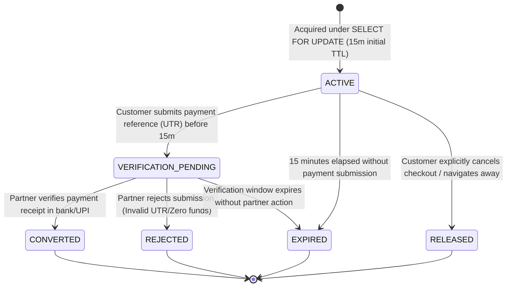
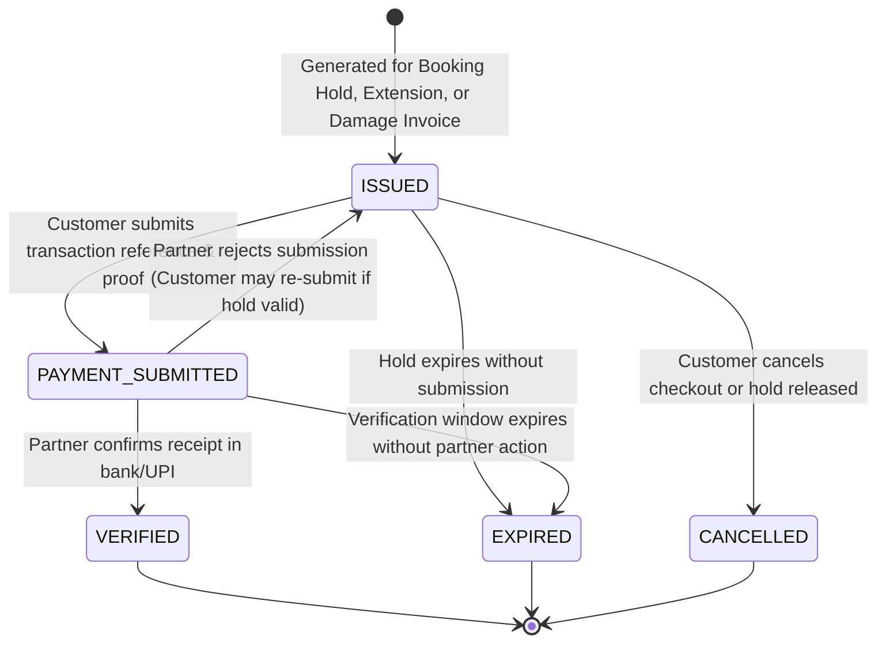
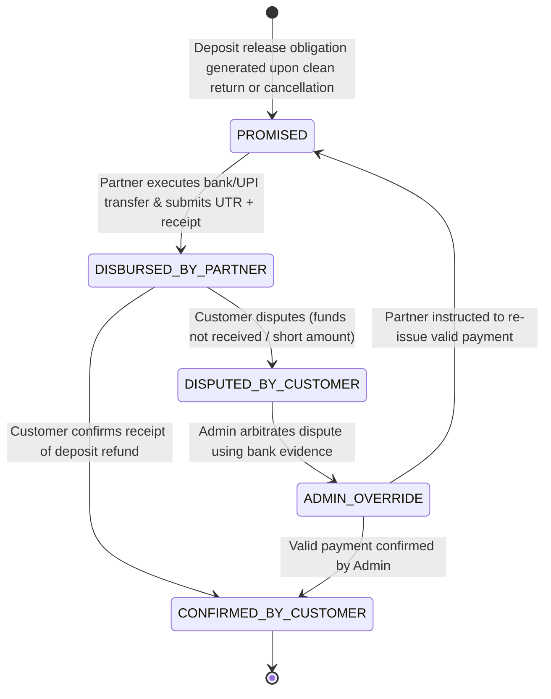
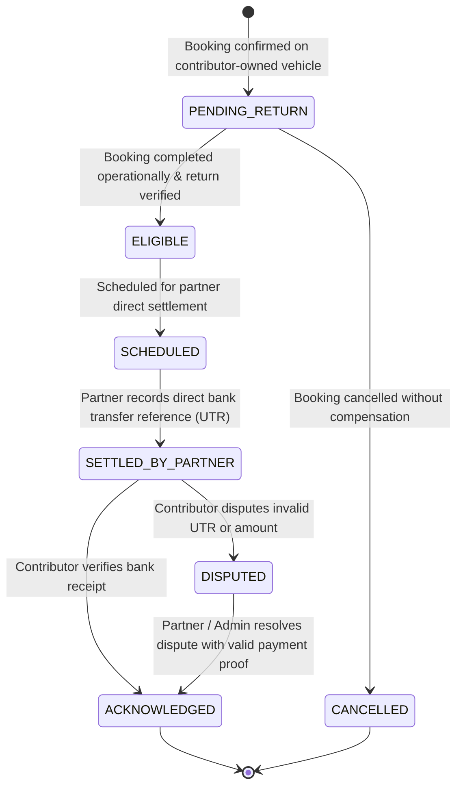

# State Machines Specification: Operational & Financial Decoupling

**Project:** Vehicle Rental Platform  
**Market:** Vijayawada, Andhra Pradesh  
**Status:** Database Design Freeze Candidate Baseline (Partner-Direct Payment Model)  
**Critical Principle:** **Operational completion is strictly decoupled from financial settlement.** A booking reaches operational completion (`COMPLETED`) when the vehicle is returned and inspected, regardless of whether deposit refunds, damage disputes, or contributor settlements remain pending, disputed, or in progress.

---

## 1. Booking Hold State Machine (Independent Reservation Lock & Verification Window)

A booking hold is a temporary slot reservation. **Creating a booking hold does NOT create an incomplete or draft record in the `bookings` table.** The `bookings` master table only receives confirmed bookings resulting from verified partner payment confirmation (or an authorized pay-at-pickup policy).

### Transition Specifications:

| From Status | To Status | Allowed Actor | Trigger / Condition | Concurrency & Database Actions | Failure Handling |
|---|---|---|---|---|---|
| `[*]` | `ACTIVE` | `CUSTOMER` | Customer clicks "Proceed to Checkout" | `SELECT id FROM vehicles WHERE id = :id FOR UPDATE;` checks for overlapping active holds, bookings, and buffers. Inserts `booking_holds` with `expires_at = NOW() + 15 MIN`. Generates initial `rental_payment_demands`. | Returns `409 Conflict` if vehicle is already locked or booked for the interval. |
| `ACTIVE` | `VERIFICATION_PENDING` | `CUSTOMER` | Customer submits direct payment proof (UTR / receipt) before initial TTL | Extends `booking_holds.expires_at = NOW() + verification_window_minutes` (e.g. 60m). Status becomes `VERIFICATION_PENDING`. Preserves inventory lock while partner verifies. | Rejects submission if hold is already expired or cancelled. |
| `VERIFICATION_PENDING` | `CONVERTED` | `RENTAL_PARTNER` | Partner independently checks bank/UPI statement and clicks "Verify Payment" | Status transitions to `CONVERTED`. Inserts new record into `bookings` (`booking_status = CONFIRMED`). Generates initial `security_deposits` record (`PENDING_COLLECTION` or `COLLECTED_HELD_BY_PARTNER`). | Concurrency check guarantees hold has not expired or already been converted. |
| `VERIFICATION_PENDING` | `REJECTED` | `RENTAL_PARTNER` | Partner rejects submission (fake UTR, no funds credited, wrong payee) | Marks submission `REJECTED`. Sets `booking_holds.status = REJECTED`. Frees vehicle calendar immediately. Customer notified with rejection reason. | Customer may restart checkout if inventory remains unreserved. |
| `ACTIVE` | `EXPIRED` | `SYSTEM` (Scheduler) | Background task runs: `NOW() > expires_at` without submission | Marks `booking_holds.status = EXPIRED`. Vehicle slot becomes immediately available for other customers. | Idempotent background task. |
| `VERIFICATION_PENDING` | `EXPIRED` | `SYSTEM` (Scheduler) | Partner fails to verify within 60-min window (`NOW() > expires_at`) | Marks `booking_holds.status = EXPIRED`. Frees inventory to avoid indefinite lock. Initiates partner non-response exception alert. | Late or unmatched payments handled via explicit partner exception/refund workflow (see Section 3.3). |
| `ACTIVE` | `RELEASED` | `CUSTOMER` | Customer clicks "Cancel Checkout" or abandons session | Marks `booking_holds.status = RELEASED`. Frees vehicle calendar immediately. | Graceful release without calendar blocking. |

---

## 2. Booking Operational State Machine

The master booking lifecycle represents the physical rental contract. It is created directly in `CONFIRMED` upon verified partner payment confirmation (or under an authorized pay-at-pickup policy).

### 2.1 Complete Transition Specifications:

| From Status | To Status | Allowed Actor | Trigger / Precondition | State Actions & Side Effects | Financial & Record Effects |
|---|---|---|---|---|---|
| `[*]` | `CONFIRMED` | `RENTAL_PARTNER` / `SYSTEM` | Payment submission marked `VERIFIED` by partner (or partner pay-at-pickup policy) | Inserts `bookings` record; logs `booking_status_events`; notifies customer and partner. | Records verified rental payment submission. Initializes `security_deposits` record in partner custody. Zero platform cash movement. |
| `CONFIRMED` | `READY_FOR_PICKUP` | `RENTAL_PARTNER` / `VEHICLE_CONTRIBUTOR` | Vehicle cleaned, staged at hub/address, and pre-rental checklist initiated | Sets `booking_status = READY_FOR_PICKUP`; customer receives pickup readiness notification. | Operational update; checks whether deposit collection is pending before key handover. |
| `CONFIRMED` | `IN_PROGRESS` | `PARTNER` / `CONTRIBUTOR` + `CUSTOMER` | Direct vehicle handover without staging state; dual inspection completed | **Handover Invariant:** Blocked until required rental amount and security deposit are confirmed collected. Sets `booking_status = IN_PROGRESS`; records `inspections` (PRE_RENTAL); logs `vehicle_custody_events`. | Partner records security deposit collection reference if collected in cash at handover. |
| `CONFIRMED` | `CANCELLED` | `CUSTOMER` / `PARTNER` / `ADMIN` | Cancellation request prior to vehicle handover | Sets `booking_status = CANCELLED`, sets `cancelled_at` and `cancellation_reason`; frees vehicle calendar immediately. | Enqueues partner refund obligation in `security_deposit_refunds` per cancellation terms; 100% security deposit marked for partner refund. |
| `CONFIRMED` | `NO_SHOW` | `RENTAL_PARTNER` / `ADMIN` | Customer fails to arrive within 2 hours of scheduled start time | Sets `booking_status = NO_SHOW`; frees vehicle calendar; alerts customer of no-show forfeiture. | Rental subtotal retained by partner per policy; 100% security deposit refunded by partner (no vehicle custody occurred). |
| `READY_FOR_PICKUP` | `IN_PROGRESS` | `PARTNER` / `CONTRIBUTOR` + `CUSTOMER` | Pickup inspection signed and digital OTP verified | **Handover Invariant:** Vehicle handover blocked until required payment and deposit verified. Sets `booking_status = IN_PROGRESS`; logs custody handover. | Deposit confirmed in partner custody. |
| `READY_FOR_PICKUP` | `CANCELLED` | `PARTNER` / `ADMIN` | Vehicle breakdown, inspection failure, or customer emergency prior to key handover | Sets `booking_status = CANCELLED`; logs incident; frees vehicle calendar. | Full 100% rental + deposit refund obligation assigned to partner in `security_deposit_refunds`. |
| `READY_FOR_PICKUP` | `NO_SHOW` | `RENTAL_PARTNER` / `ADMIN` | Customer fails to claim vehicle within 2 hours of start | Sets `booking_status = NO_SHOW`; frees vehicle calendar. | Rental amount retained per policy; security deposit refunded by partner. |
| `IN_PROGRESS` | `OVERDUE` | `SYSTEM` (Scheduled) | Current time exceeds `ends_at` + 30-min buffer without extension | Sets `booking_status = OVERDUE`; alerts fleet manager, customer, and support; initiates penalty tracking. | Accrues hourly late fee penalty to be claimed by partner against security deposit. |
| `IN_PROGRESS` | `RETURNED` | `PARTNER` / `CONTRIBUTOR` + `CUSTOMER` | Vehicle returned on time/early; physical return inspection executed | Sets `booking_status = RETURNED`; records `inspections` (POST_RENTAL); logs `vehicle_custody_events` (handover back to partner/owner). | Initiates deposit return evaluation in `security_deposits`. |
| `OVERDUE` | `RETURNED` | `PARTNER` / `CONTRIBUTOR` + `CUSTOMER` | Overdue vehicle returned; physical return inspection executed | Sets `booking_status = RETURNED`; logs `vehicle_custody_events`; attaches late penalty calculation. | Partner logs deposit deduction proposal for overdue charges. |
| `RETURNED` | `COMPLETED` | `RENTAL_PARTNER` / `SYSTEM` | Operational return signed off; vehicle inspected and released for next rental | Sets `booking_status = COMPLETED`. Triggers contributor payable eligibility in `contributor_payables`. | Financial settlement runs independently; does not block operational completion. |

### 2.2 Disallowed Transitions & Terminal Invariants:
- **Terminal States:** `COMPLETED`, `CANCELLED`, and `NO_SHOW` are **strictly terminal**. No transitions out of these states are permitted under any circumstances.
- **In-Custody Protections:** A booking in `IN_PROGRESS` or `OVERDUE` **cannot be cancelled or marked as no-show**. It must physically terminate via `RETURNED`.
- **Operational Decoupling:** Failed or disputed deposit refunds, damage claim arbitrations, or contributor payouts **never revert a `COMPLETED`, `CANCELLED`, or `NO_SHOW` booking**.

---

## 3. Rental Payment Demand, Submission & Verification Lifecycles

In the Partner-Direct model, customer payments flow directly to the managing partner's UPI QR, UPI ID, payment link, or cash at pickup. The platform manages the demand, records customer submission proof, and enforces manual partner verification.

### 3.1 Rental Payment Demand Lifecycle (`rental_payment_demands`)

### 3.2 Customer Payment Submission Lifecycle (`rental_payment_submissions`)

```mermaid
stateDiagram-v2
    [*] --> SUBMITTED_FOR_VERIFICATION: Customer inputs UTR, Amount, Time & Receipt
    
    SUBMITTED_FOR_VERIFICATION --> VERIFIED: Partner independently verifies bank/UPI credit
    SUBMITTED_FOR_VERIFICATION --> REJECTED: Partner finds no credit / invalid UTR / wrong amount
    
    VERIFIED --> [*]: Triggers Booking CONFIRMED
    REJECTED --> [*]: Reason logged; customer alerted
```

### 3.3 State Transition Specifications & Validation Rules:

| From Status | To Status | Allowed Actor | Trigger / Condition | Concurrency & Validation Rules | Side Effects |
|---|---|---|---|---|---|
| `[*]` | `SUBMITTED_FOR_VERIFICATION` | `CUSTOMER` | Customer transfers money to partner and submits UTR/reference | 1. Verifies parent demand is in `ISSUED` or `PAYMENT_SUBMITTED`. 2. Verifies hold has not reached `EXPIRED`. 3. Enforces unique check on `(manager_partner_id, transaction_reference)` to prevent reference reuse. 4. Stores timestamp, amount, payment method, and optional receipt object key. | Hold transitions to `VERIFICATION_PENDING`; TTL extended by verification window (e.g. 60m). Partner notified via in-app/SMS alert. |
| `SUBMITTED_FOR_VERIFICATION` | `VERIFIED` | `RENTAL_PARTNER` | Partner checks UPI app/bank statement and verifies receipt of exact amount | 1. **Strict Partner Auth:** ONLY users belonging to the managing `partner_profile` can execute verification. 2. **Anti-Auto-Verification Invariant:** Customer screenshot/UTR NEVER auto-verifies; only explicit partner API call transitions status. 3. Verifies hold/demand has not expired. | Transitions `rental_payment_demands.status = VERIFIED`. Triggers `BookingConfirmedEvent`. Creates master `bookings` row. |
| `SUBMITTED_FOR_VERIFICATION` | `REJECTED` | `RENTAL_PARTNER` | Partner inspects bank statement and finds no credit or wrong amount | 1. Partner supplies mandatory `rejection_reason` (e.g., `UTR_NOT_FOUND`, `AMOUNT_MISMATCH`, `PAYMENT_DECLINED`). 2. Verifies actor belongs to managing partner organization. | Logs rejection with timestamp and partner user ID. Notifies customer with rejection details. If hold TTL remains, customer can re-submit valid UTR; otherwise hold transitions to `EXPIRED`. |

### 3.4 Edge Cases & Failure Scenarios:

1. **Duplicate Transaction Reference:**
   - Database constraint `uk_submissions_partner_ref` (`manager_partner_id`, `transaction_reference`) rejects any attempt to submit an already-used UTR for the same partner.
   - Prevents malicious customers from recycling older payment receipts across multiple bookings.
2. **Payment Amount Mismatch:**
   - If customer transfers ₹1,000 but demand is ₹1,500, the partner rejects with reason `AMOUNT_MISMATCH`.
   - The platform allows the customer to submit a supplemental transaction reference for the balance, or the partner cancels the demand and returns the partial transfer outside the platform.
3. **Expired Hold & Late Payment:**
   - If customer pays partner UPI after the 15-minute hold expires, and the vehicle is subsequently booked by another customer:
     - The booking is **NOT automatically created or recovered** if the calendar is occupied.
     - The system flags a `LATE_PAYMENT_EXCEPTION`.
     - The partner is notified to execute an external refund of the customer's transfer outside the platform, or coordinate an alternative vehicle assignment.
4. **Partner Non-Response During Verification Window:**
   - Configurable verification window (e.g. 60 minutes) prevents indefinite vehicle calendar locking.
   - Automated alerts dispatched to partner at 30 minutes and 45 minutes.
   - At 60 minutes without partner verification, the hold transitions to `EXPIRED` and inventory is released.
   - If the customer genuinely paid, customer can submit a support ticket (`PAYMENT` category), and Admin facilitates partner verification or external refund.

---

## 4. Security Deposit Custody & Refund State Machine (`security_deposits`)

Security deposits are collected directly by the managing partner, held in partner custody, and refunded directly by the partner. **A disputed damage claim is NEVER automatically approved merely because a 48-hour response window expires.**

```mermaid
stateDiagram-v2
    [*] --> PENDING_COLLECTION: Initialized upon booking confirmation
    PENDING_COLLECTION --> COLLECTED_HELD_BY_PARTNER: Partner verifies deposit collection
    
    COLLECTED_HELD_BY_PARTNER --> FULLY_REFUNDED: 1. Clean return inspection OR 2. Pre-pickup cancellation
    COLLECTED_HELD_BY_PARTNER --> DEDUCTION_PROPOSED: Post-rental inspection logs damage/fuel/late fee
    
    DEDUCTION_PROPOSED --> DISPUTED: Customer challenges deduction within 48h
    DEDUCTION_PROPOSED --> PENDING_ADMIN_REVIEW: Customer does not respond within 48h
    
    DISPUTED --> ADMIN_ARBITRATION: Admin reviews photos, GPS logs, inspection reports
    PENDING_ADMIN_REVIEW --> ADMIN_ARBITRATION: Admin verifies partner evidence before approving
    
    ADMIN_ARBITRATION --> PARTIALLY_REFUNDED: Admin upholds partial deduction; partner refunds remainder
    ADMIN_ARBITRATION --> FULLY_REFUNDED: Admin rejects partner claim; partner refunds 100%
    ADMIN_ARBITRATION --> RETAINED_FOR_DAMAGE: Admin approves 100% deposit forfeiture for severe damage
    
    PARTIALLY_REFUNDED --> CLOSED: All refunds confirmed / balance ₹0
    FULLY_REFUNDED --> CLOSED: 100% refunded / balance ₹0
    RETAINED_FOR_DAMAGE --> CLOSED: 100% deducted / balance ₹0
    
    CLOSED --> [*]
```

### Review and Resolution Rules:
1. **Direct Partner Custody:** The partner is the physical and legal custodian of the security deposit funds. The platform records expected amount, collected reference, refund reference, and evidence.
2. **Immediate Release of Undisputed Balance:** If the deposit is ₹5,000 and the damage claim is ₹1,500, the uncontested ₹3,500 must be **immediately refunded** by the partner directly to the customer.
3. **48-Hour Customer Window:** The customer is notified of the proposed deduction and has 48 hours to either agree or dispute with counter-evidence.
4. **Disputed Claims:** Status moves to `DISPUTED` and enters `ADMIN_ARBITRATION`. Admin evaluates pre-rental vs. post-rental inspection media, GPS logs, and repair estimates. No deduction is approved without Admin review.
5. **Non-Responsive Claims:** If the customer does not respond within 48 hours, status moves to `PENDING_ADMIN_REVIEW`. An Admin must verify the partner's evidence before approving any deduction.

---

## 5. Security Deposit Direct Refund State Machine (`security_deposit_refunds`)

Tracks direct refund execution by the rental partner outside the platform. The platform records, monitors, and audits refunds, but does not execute external gateway transfers.

### Refund Transition Specifications:

| From Status | To Status | Allowed Actor | Trigger / Condition | State Actions & Evidence Rules |
|---|---|---|---|---|
| `[*] ` | `PROMISED` | `SYSTEM` / `PARTNER` | Clean return inspection completed or booking cancelled prior to pickup | Inserts `security_deposit_refunds` record; sets `refund_amount = undisputed_balance`. Notifies partner of pending refund obligation. |
| `PROMISED` | `DISBURSED_BY_PARTNER` | `RENTAL_PARTNER` | Partner transfers funds via UPI/NEFT to customer and enters UTR | Partner provides mandatory `refund_transaction_reference` (UTR), `refund_method`, and optional receipt upload. Sets `refunded_at = NOW()`. |
| `DISBURSED_BY_PARTNER` | `CONFIRMED_BY_CUSTOMER` | `CUSTOMER` / `SYSTEM` | Customer confirms receipt (or 72h auto-acknowledgement window expires without dispute) | Sets `status = CONFIRMED_BY_CUSTOMER`, `acknowledged_at = NOW()`. Updates parent `security_deposits.status = CLOSED`. |
| `DISBURSED_BY_PARTNER` | `DISPUTED_BY_CUSTOMER` | `CUSTOMER` | Customer reports funds not credited within 72h | Sets `status = DISPUTED_BY_CUSTOMER`. Customer provides bank statement showing non-receipt. Escalates to Admin Support. |
| `DISPUTED_BY_CUSTOMER` | `ADMIN_OVERRIDE` | `ADMIN` | Admin reviews bank statements from both partner and customer | If transfer was successful, Admin marks `CONFIRMED_BY_CUSTOMER`. If transfer failed or fake UTR was provided, Admin reverts to `PROMISED` and issues partner compliance warning. |

---

## 6. Vehicle Custody State Machine (Generic & Ownership-Independent)

Physical vehicle custody is modeled **independently of vehicle legal ownership and booking status**.

### Initial Custody Rules:
- **Partner-Owned Vehicles (`PARTNER_OWNED`):** Begin in `PARTNER_CUSTODY` upon verification and hub assignment.
- **Contributor-Owned Vehicles (`CONTRIBUTOR_OWNED`):** Begin in `CONTRIBUTOR_CUSTODY` upon registration; transition to `PARTNER_CUSTODY` upon hub onboarding, or remain in `CONTRIBUTOR_CUSTODY` for owner-managed handovers.

### The 8 Canonical Custody Permutations (`vehicle_custody_events`):
1. `CONTRIBUTOR_TO_PARTNER`: Contributor delivers vehicle to partner hub for fleet onboarding.
2. `PARTNER_TO_CUSTOMER`: Customer picks up vehicle at partner hub (partner-managed handover).
3. `CONTRIBUTOR_TO_CUSTOMER`: Customer picks up vehicle directly from contributor residence (**owner-managed direct handover**).
4. `CUSTOMER_TO_PARTNER`: Customer returns vehicle to partner hub (partner-managed return).
5. `CUSTOMER_TO_CONTRIBUTOR`: Customer returns vehicle directly to contributor residence (**owner-managed direct return**).
6. `PARTNER_TO_CONTRIBUTOR`: Partner returns vehicle to contributor upon agreement termination or withdrawal.
7. `INTER_HUB_TRANSFER`: Partner relocates vehicle between two operational depots in the city.
8. `LOGISTICS_RELOCATION`: Authorized representative / logistics driver handles doorstep delivery or recovery.

---

## 7. Contributor Payable & Settlement Lifecycle (Approach A Direct Settlement)

Tracks the partner's contractual obligation to the contributor. **The rental partner is the sole legal debtor.** The partner pays the contributor directly outside the platform. Direct payments are **never represented as platform cash disbursements**.

### Transition Specifications:

| From Status | To Status | Allowed Actor | Trigger / Condition | State Actions & Audit Rules |
|---|---|---|---|---|
| `[*] ` | `PENDING_RETURN` | `SYSTEM` | Contributor vehicle booking is confirmed | Inserts `contributor_payables` row with fixed fee from agreement terms. Single lump-sum model enforced. |
| `PENDING_RETURN` | `ELIGIBLE` | `SYSTEM` | Booking reaches `COMPLETED` operational status | Marks payable `ELIGIBLE`. Notifies partner that payment is due per agreement schedule. |
| `PENDING_RETURN` | `CANCELLED` | `SYSTEM` | Booking cancelled before completion | Sets `payable_status = CANCELLED` unless signed agreement contains `cancellation_compensation_rate`. |
| `ELIGIBLE` | `SCHEDULED` | `RENTAL_PARTNER` | Partner flags payable for immediate batch settlement | Sets `payable_status = SCHEDULED`. |
| `SCHEDULED` | `SETTLED_BY_PARTNER` | `RENTAL_PARTNER` | Partner executes direct NEFT/IMPS/UPI payment to contributor bank account | Partner inputs Bank UTR number (`bank_transaction_reference`), transfer date, and optional receipt document. Sets `partner_settled_at = NOW()`. Notifies contributor. |
| `SETTLED_BY_PARTNER` | `ACKNOWLEDGED` | `VEHICLE_CONTRIBUTOR` / `SYSTEM` | Contributor confirms receipt of funds in bank account (or 7-day auto-acknowledgement window expires) | Sets `payable_status = ACKNOWLEDGED`, `contributor_acknowledged_at = NOW()`. Terminal completed state. |
| `SETTLED_BY_PARTNER` | `DISPUTED` | `VEHICLE_CONTRIBUTOR` | Contributor reports non-receipt of funds or incorrect amount | Sets `payable_status = DISPUTED`. Contributor provides bank statement proof. Alerts Admin Support for dispute mediation. |
| `DISPUTED` | `ACKNOWLEDGED` | `ADMIN` / `RENTAL_PARTNER` | Partner re-executes payment or provides verified bank NOC | Admin validates payment evidence and resolves dispute. Sets `payable_status = ACKNOWLEDGED`. |
