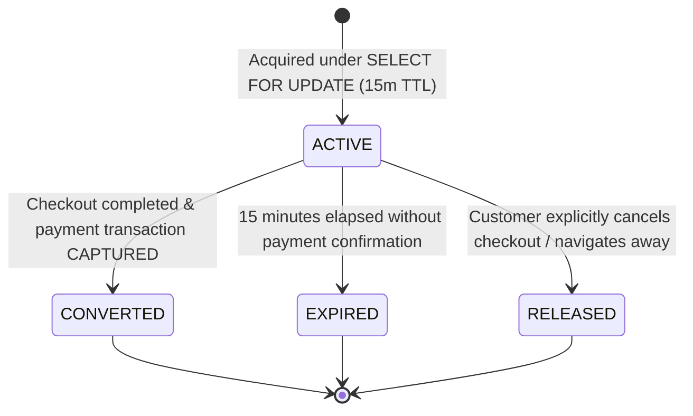
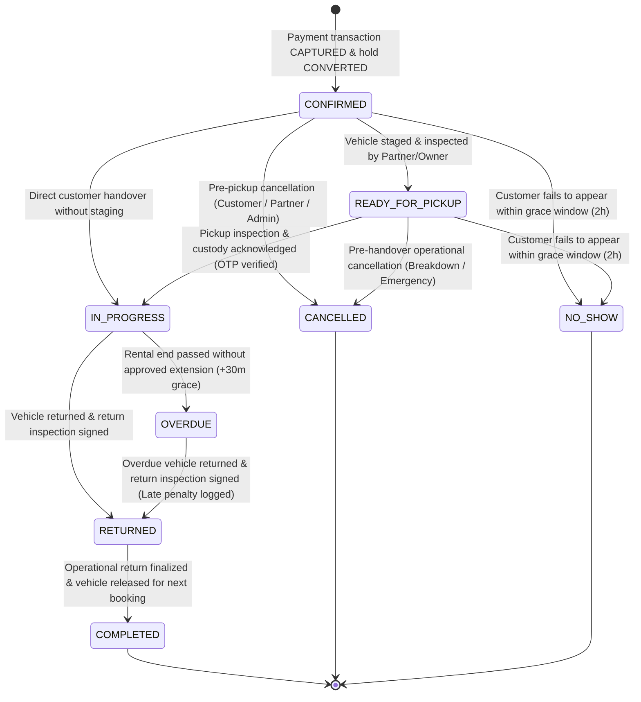
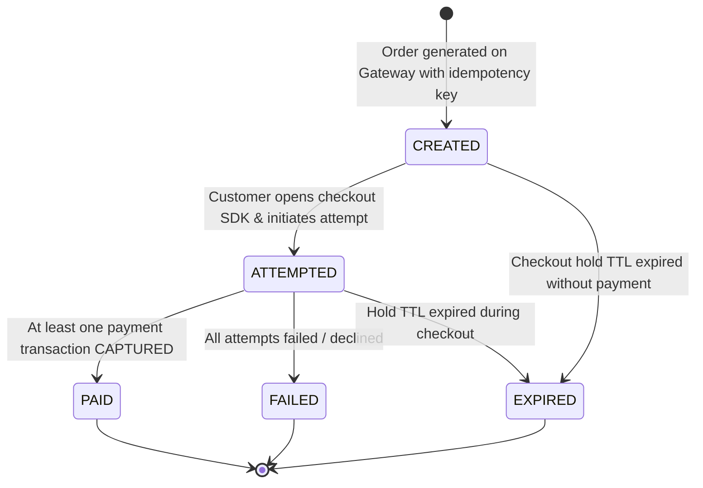
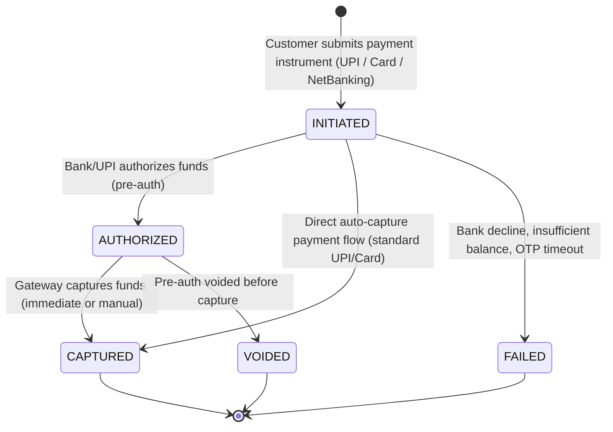
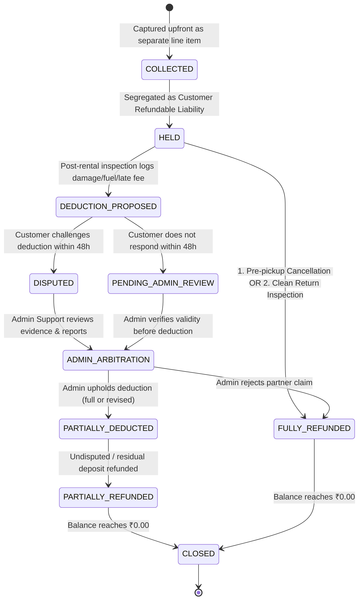
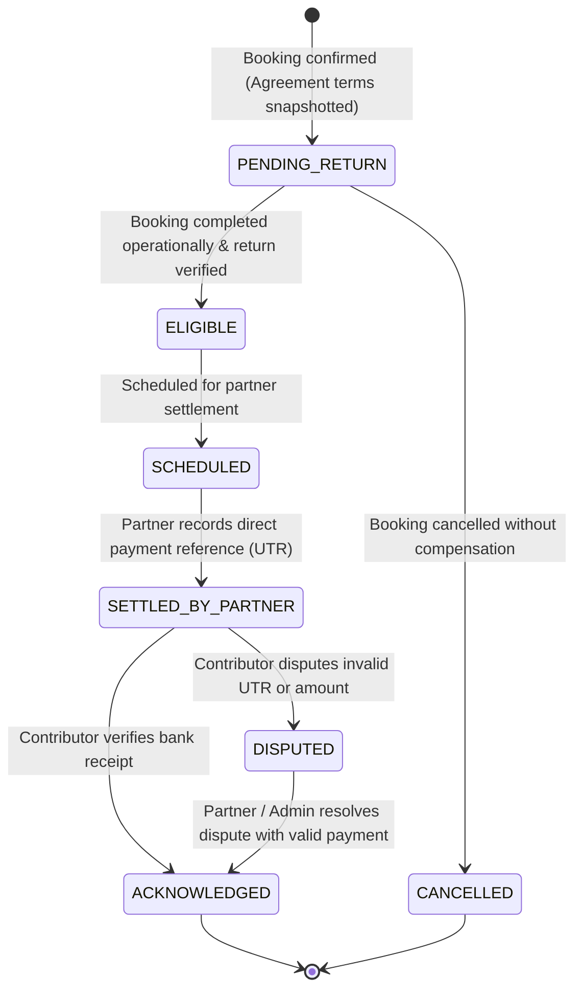
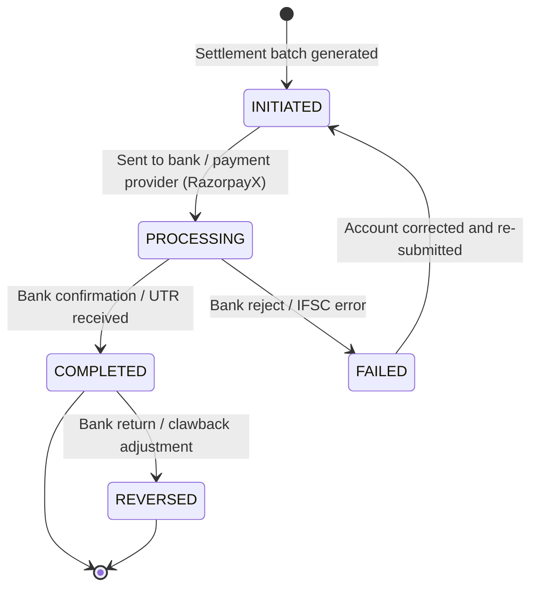

# State Machines Specification: Operational & Financial Decoupling

**Project:** Vehicle Rental Platform  
**Market:** Vijayawada, Andhra Pradesh  
**Status:** Database Design Freeze Candidate Baseline (54-Table Architecture)  
**Critical Principle:** **Operational completion is strictly decoupled from financial settlement.** A booking reaches operational completion (`COMPLETED`) when the vehicle is returned and inspected, regardless of whether deposit refunds, damage disputes, or partner/contributor settlements remain pending, disputed, or failed.

---

## 1. Booking Hold State Machine (Independent Reservation Lock)

A booking hold is a temporary slot reservation. **Creating a booking hold does NOT create an incomplete or draft record in the `bookings` table.** The `bookings` master table only receives confirmed bookings resulting from successful payment transactions.

### Transition Specifications:

| From Status | To Status | Allowed Actor | Trigger / Condition | Concurrency & Database Actions | Failure Handling |
|---|---|---|---|---|---|
| `[*]` | `ACTIVE` | `CUSTOMER` | Customer clicks "Proceed to Checkout" | `SELECT id FROM vehicles WHERE id = :id FOR UPDATE;` checks for overlapping holds/bookings/buffers. Inserts into `booking_holds` with `expires_at = NOW() + 15 MIN`. | Returns `409 Conflict` if vehicle is already locked or booked for the interval. |
| `ACTIVE` | `CONVERTED` | `SYSTEM` (Webhook) | Payment gateway webhook confirms successful capture before `expires_at` | Transitions `booking_holds.status = CONVERTED`. Inserts new record into `bookings` (`booking_status = CONFIRMED`). | Transactional; rollback if booking insertion fails. |
| `ACTIVE` | `EXPIRED` | `SYSTEM` (Scheduler) | Background task runs: `NOW() > expires_at` | Marks `booking_holds.status = EXPIRED`. Vehicle slot becomes immediately available for other customers. | Handled safely if late payment webhook arrives (see Section 3). |
| `ACTIVE` | `RELEASED` | `CUSTOMER` | Customer clicks "Cancel Checkout" or abandons session | Marks `booking_holds.status = RELEASED`. Frees vehicle calendar immediately. | Graceful release without calendar blocking. |

---

## 2. Booking Operational State Machine

The master booking lifecycle represents the physical rental contract. It is created directly in `CONFIRMED` upon successful hold conversion and payment capture.

### 2.1 Complete Transition Specifications:

| From Status | To Status | Allowed Actor | Trigger / Precondition | State Actions & Side Effects | Financial & Ledger Effects |
|---|---|---|---|---|---|
| `[*]` | `CONFIRMED` | `SYSTEM` (Webhook) | Payment order captured and hold converted | Inserts `bookings` record; logs `booking_status_events`; notifies customer and fleet manager. | Posts `ledger_transactions` (debit `GATEWAY_CLEARING`, credit `CUSTOMER_RENTAL_CLEARING` and `CUSTOMER_REFUNDABLE_LIABILITY`). |
| `CONFIRMED` | `READY_FOR_PICKUP` | `RENTAL_PARTNER` / `VEHICLE_CONTRIBUTOR` | Vehicle cleaned, staged at hub/address, and pre-rental checklist initiated | Sets `booking_status = READY_FOR_PICKUP`; customer receives pickup readiness notification. | None (operational status update). |
| `CONFIRMED` | `IN_PROGRESS` | `PARTNER` / `CONTRIBUTOR` + `CUSTOMER` | Direct vehicle handover without staging state; dual inspection completed | Sets `booking_status = IN_PROGRESS`; records `inspections` (PRE_RENTAL); logs `vehicle_custody_events` (`CUSTOMER_CUSTODY`). | Earns rental clearing: debit `CUSTOMER_RENTAL_CLEARING`, credit `PLATFORM_COMMISSION_REVENUE` and `PARTNER_PAYABLE`. |
| `CONFIRMED` | `CANCELLED` | `CUSTOMER` / `PARTNER` / `ADMIN` | Cancellation request prior to vehicle handover | Sets `booking_status = CANCELLED`, sets `cancelled_at` and `cancellation_reason`; frees vehicle calendar immediately. | Enqueues refund in `refunds` according to `cancellation_policy_snapshot`; 100% security deposit refunded. |
| `CONFIRMED` | `NO_SHOW` | `RENTAL_PARTNER` / `ADMIN` | Customer fails to arrive within 2 hours of scheduled start time | Sets `booking_status = NO_SHOW`; frees vehicle calendar; alerts customer of no-show forfeiture. | Rental subtotal retained per policy; 100% security deposit refunded via `refunds` (no custody occurred). |
| `READY_FOR_PICKUP` | `IN_PROGRESS` | `PARTNER` / `CONTRIBUTOR` + `CUSTOMER` | Pickup inspection signed and digital OTP verified | Sets `booking_status = IN_PROGRESS`; records `inspections` (PRE_RENTAL); logs `vehicle_custody_events` (`CUSTOMER_CUSTODY`). | Earns rental clearing: debit `CUSTOMER_RENTAL_CLEARING`, credit `PLATFORM_COMMISSION_REVENUE` and `PARTNER_PAYABLE`. |
| `READY_FOR_PICKUP` | `CANCELLED` | `PARTNER` / `ADMIN` | Vehicle breakdown, inspection failure, or customer emergency prior to key handover | Sets `booking_status = CANCELLED`; logs incident; frees vehicle calendar. | Full 100% rental + deposit refund enqueued in `refunds`; partner compensation/penalty evaluated. |
| `READY_FOR_PICKUP` | `NO_SHOW` | `RENTAL_PARTNER` / `ADMIN` | Customer fails to claim vehicle within 2 hours of start | Sets `booking_status = NO_SHOW`; frees vehicle calendar. | Rental subtotal retained per policy; 100% security deposit refunded. |
| `IN_PROGRESS` | `OVERDUE` | `SYSTEM` (Scheduled) | Current time exceeds `ends_at` + 30-min buffer without extension | Sets `booking_status = OVERDUE`; alerts fleet manager, customer, and support; initiates penalty tracking. | Accrues hourly late fee penalty to be claimed against security deposit. |
| `IN_PROGRESS` | `RETURNED` | `PARTNER` / `CONTRIBUTOR` + `CUSTOMER` | Vehicle returned on time/early; physical return inspection executed | Sets `booking_status = RETURNED`; records `inspections` (POST_RENTAL); logs `vehicle_custody_events` (handover back to partner/owner). | Initiates deposit settlement evaluation in `security_deposits`. |
| `OVERDUE` | `RETURNED` | `PARTNER` / `CONTRIBUTOR` + `CUSTOMER` | Overdue vehicle returned; physical return inspection executed | Sets `booking_status = RETURNED`; logs `vehicle_custody_events`; attaches late penalty calculation. | Initiates deposit deduction proposal for overdue charges. |
| `RETURNED` | `COMPLETED` | `RENTAL_PARTNER` / `SYSTEM` | Operational return signed off; vehicle inspected and released for next rental | Sets `booking_status = COMPLETED`. Triggers contributor payable eligibility in `contributor_payables`. | Financial settlement runs independently; does not block operational completion. |

### 2.2 Disallowed Transitions & Terminal Invariants:
- **Terminal States:** `COMPLETED`, `CANCELLED`, and `NO_SHOW` are **strictly terminal**. No transitions out of these states are permitted under any circumstances.
- **In-Custody Protections:** A booking in `IN_PROGRESS` or `OVERDUE` **cannot be cancelled or marked as no-show**. It must physically terminate via `RETURNED`.
- **Operational Decoupling:** Failed or disputed financial refunds, damage claim arbitrations, or partner disbursements **never revert a `COMPLETED`, `CANCELLED`, or `NO_SHOW` booking**.

---

## 3. Payment Order, Transaction Attempt & Late Webhook Handling

Payment gateways distinguish between the high-level payment order and individual transaction attempts.

### A. Payment Order Lifecycle (`payment_orders`)

### B. Payment Transaction/Attempt Lifecycle (`payment_transactions`)

### C. Late Payment Webhook Recovery State Transitions:
When a payment gateway delivers a `payment.captured` webhook for a hold that has already reached `EXPIRED` or `RELEASED`, the system executes an automated, idempotent recovery protocol:

```mermaid
stateDiagram-v2
    [*] --> LATE_WEBHOOK_RECEIVED: payment.captured received for EXPIRED/RELEASED hold
    LATE_WEBHOOK_RECEIVED --> DEDUPLICATED: Verify HMAC signature & check payment_webhook_events
    
    DEDUPLICATED --> LOCK_ACQUIRED: Acquire SELECT FOR UPDATE on vehicle_id
    LOCK_ACQUIRED --> AVAILABILITY_EVALUATION: Check overlapping holds, bookings, and turnaround buffers
    
    AVAILABILITY_EVALUATION --> HOLD_RECOVERED: Vehicle interval still 100% available
    HOLD_RECOVERED --> BOOKING_CONFIRMED: Hold CONVERTED -> Booking CONFIRMED -> Ledger posted
    BOOKING_CONFIRMED --> [*]: Customer notified: "Booking confirmed successfully"
    
    AVAILABILITY_EVALUATION --> HOLD_COLLISION: Vehicle interval reserved by another customer in interim
    HOLD_COLLISION --> REFUND_DISPATCHED: Hold remains EXPIRED -> 100% Refund queued -> Ledger posted
    REFUND_DISPATCHED --> [*]: Customer notified: "Reservation expired; 100% refund initiated"
```

#### Late Webhook State Transition Matrix:

| Initial Hold Status | Gateway Event | Concurrency Guard | Availability Check Result | Target Hold Status | Booking Action | Refund Action | Ledger Transaction |
|---|---|---|---|---|---|---|---|
| `ACTIVE` | `payment.captured` | Optimistic Versioning | Not required (hold already locks slot) | `CONVERTED` | Insert `bookings` (`CONFIRMED`) | None | DR `GATEWAY_CLEARING`, CR `CUSTOMER_RENTAL_CLEARING`, CR `CUSTOMER_REFUNDABLE_LIABILITY` |
| `EXPIRED` / `RELEASED` | `payment.captured` | `SELECT id FROM vehicles WHERE id = :id FOR UPDATE` | **AVAILABLE** (Zero overlapping holds or bookings) | `CONVERTED` (Late Recovery) | Insert `bookings` (`CONFIRMED`) | None | DR `GATEWAY_CLEARING`, CR `CUSTOMER_RENTAL_CLEARING`, CR `CUSTOMER_REFUNDABLE_LIABILITY` |
| `EXPIRED` / `RELEASED` | `payment.captured` | `SELECT id FROM vehicles WHERE id = :id FOR UPDATE` | **COLLISION** (Interval booked by another customer) | `EXPIRED` (Retained) | **None** (No booking created) | Insert `refunds` (`AUTO_REFUND_EXPIRED_HOLD`, `QUEUED`) | DR `GATEWAY_CLEARING`, CR `REFUND_PAYABLE`; upon dispatch: DR `REFUND_PAYABLE`, CR `GATEWAY_CLEARING` |

---

## 4. Refund State Machine & Decoupled Failed Refund Recovery (`refunds`)

Every outward refund (cancellation, deposit release, dispute resolution, or delayed webhook auto-refund) is tracked independently with full retry and reconciliation support.

> [!IMPORTANT]
> **Orthogonal & Decoupled from Booking Status:**
> The refund lifecycle is strictly orthogonal to and independent of `bookings.booking_status`. A failed refund **never regresses, re-opens, or alters** a booking. A booking that is `COMPLETED`, `CANCELLED`, or `NO_SHOW` remains permanently in that state. Failed refund recovery operates entirely within the `refunds` state machine and finance queue.

```mermaid
stateDiagram-v2
    [*] --> INITIATED: Refund request created with unique idempotency key
    INITIATED --> PROCESSING: Outward API request dispatched to Gateway
    
    PROCESSING --> SUCCEEDED: Gateway webhook / sync confirms refund settled to customer
    PROCESSING --> FAILED: Gateway returns error (network timeout, bank reject, insufficient balance)
    
    FAILED --> RETRY_QUEUED: Transient error; scheduled for exponential backoff retry (15m, 1h, 4h)
    RETRY_QUEUED --> PROCESSING: Outbox scheduled worker retries gateway dispatch
    
    FAILED --> MANUAL_REVIEW: Permanent decline OR retries exhausted (>= 3 attempts)
    MANUAL_REVIEW --> PROCESSING: Finance corrects gateway configuration / balance and retries
    MANUAL_REVIEW --> OFFLINE_SETTLED: Finance settles directly to customer bank account (NEFT/IMPS)
    
    SUCCEEDED --> [*]
    OFFLINE_SETTLED --> [*]
```

### 4.1 Refund Failure & Recovery Transition Specifications:

| From Status | To Status | Allowed Actor | Trigger / Condition | State Actions & Recovery Mechanism |
|---|---|---|---|---|
| `INITIATED` | `PROCESSING` | `SYSTEM` (Outbox) | Dispatch worker sends refund instruction to Gateway API | Stores gateway refund ID; sets `dispatched_at = NOW()`. |
| `PROCESSING` | `SUCCEEDED` | `SYSTEM` (Webhook) | Gateway confirms refund settled to customer bank/card | Sets `refund_status = SUCCEEDED`, `settled_at = NOW()`. Extinguishes `REFUND_PAYABLE` in general ledger. |
| `PROCESSING` | `FAILED` | `SYSTEM` | Gateway returns error or timeout | Increments `attempt_count`; records error code and message. |
| `FAILED` | `RETRY_QUEUED` | `SYSTEM` | `attempt_count < 3` AND error is transient (HTTP 503, Gateway rate limit, connection drop) | Schedules next retry with exponential backoff: $T_{next} = NOW() + (15 \times 2^{\text{attempt}-1})\text{ min}$. |
| `RETRY_QUEUED` | `PROCESSING` | `SYSTEM` (Scheduler) | Scheduled retry time reached (`next_retry_at <= NOW()`) | ShedLock-protected scheduled worker re-dispatches refund request using original idempotency key. |
| `FAILED` | `MANUAL_REVIEW` | `SYSTEM` | `attempt_count >= 3` OR error is permanent (customer card blocked, account frozen, invalid VPA) | Escalates to Finance/Admin Support; creates urgent alert in `incidents`; alerts finance team. |
| `MANUAL_REVIEW` | `PROCESSING` | `FINANCE_ADMIN` | Finance funds gateway merchant balance or updates gateway dispatch parameters | Resets retry counter; dispatches fresh refund attempt to gateway. |
| `MANUAL_REVIEW` | `OFFLINE_SETTLED` | `FINANCE_ADMIN` | Customer provides alternate bank details; Finance executes direct manual NEFT/IMPS transfer | Records Bank UTR number, transfer timestamp, and approver user ID in refund metadata. Extinguishes `REFUND_PAYABLE`. |

---

## 5. Security Deposit & Dispute Resolution State Machine (`security_deposits`)

Security deposits are refundable liabilities. **A disputed damage claim is NEVER automatically approved merely because a 48-hour response window expires.**

### Review and Resolution Process:
1. **Immediate Release of Undisputed Balance:** If the deposit is ₹5,000 and the claim is ₹1,500, the uncontested ₹3,500 is **immediately refunded** to the customer via the refund pipeline.
2. **48-Hour Customer Window:** The customer is notified and has 48 hours to either accept or dispute the claim with counter-evidence.
3. **Disputed Claims:** Status moves to `DISPUTED` and enters `ADMIN_ARBITRATION`. Admin evaluates pre-rental vs. post-rental media, GPS logs, and repair estimates before deciding. No funds are deducted automatically.
4. **Non-Responsive Claims:** If the customer does not respond within 48 hours, status moves to `PENDING_ADMIN_REVIEW`. Admin verifies partner evidence before approving any deduction from the deposit liability.

---

## 6. Vehicle Custody State Machine (Generic & Ownership-Independent)

Physical vehicle custody is modeled **independently of vehicle legal ownership and booking status**.

### Initial Custody Rules:
- **Partner-Owned Vehicles (`PARTNER_OWNED`):** Begin in `PARTNER_CUSTODY` upon verification and hub assignment.
- **Contributor-Owned Vehicles (`CONTRIBUTOR_OWNED`):** Begin in `CONTRIBUTOR_CUSTODY` upon registration; transition to `PARTNER_CUSTODY` upon hub onboarding, or remain in `CONTRIBUTOR_CUSTODY` for owner-managed handovers.

### The 8 Canonical Custody Permutations (`vehicle_custody_events`):
1. `CONTRIBUTOR_TO_PARTNER`: Contributor delivers vehicle to partner hub for fleet onboarding.
2. `PARTNER_TO_CUSTOMER`: Customer picks up vehicle at partner hub (partner-managed handover).
3. `CONTRIBUTOR_TO_CUSTOMER`: Customer picks up vehicle directly from contributor residence (**owner-managed direct handover**).
4. `CUSTOMER_TO_PARTNER`: Customer returns vehicle to partner hub (partner-managed return).
5. `CUSTOMER_TO_CONTRIBUTOR`: Customer returns vehicle directly to contributor residence (**owner-managed direct return**).
6. `PARTNER_TO_CONTRIBUTOR`: Partner returns vehicle to contributor upon agreement termination or withdrawal.
7. `INTER_HUB_TRANSFER`: Partner relocates vehicle between two operational depots in the city.
8. `LOGISTICS_RELOCATION`: Authorized representative / logistics driver handles doorstep delivery or recovery.

---

## 7. Contributor Payable & Settlement Lifecycles

### A. Contributor Payable Lifecycle (`contributor_payables`)
Tracks the partner's contractual obligation to the contributor. **The rental partner is the sole legal debtor.** This is tracked in `contributor_payables`, strictly separate from the platform general ledger.

### B. Partner Net Settlement Lifecycle (`settlements`)
Tracks outward platform disbursements to rental partners for net rental proceeds from the platform bank account.

