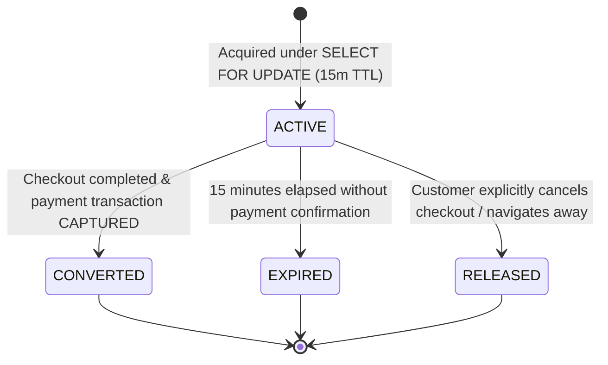
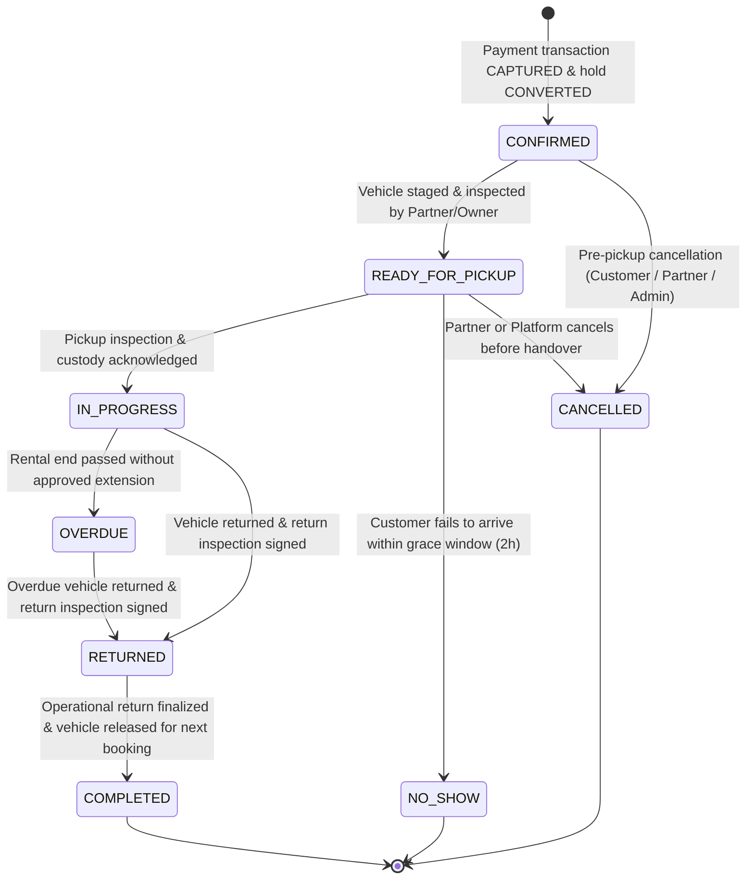
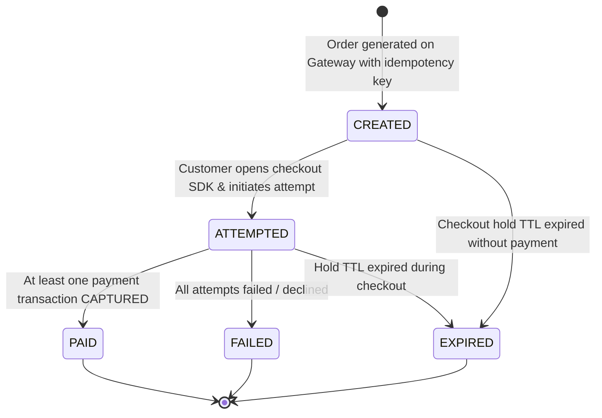
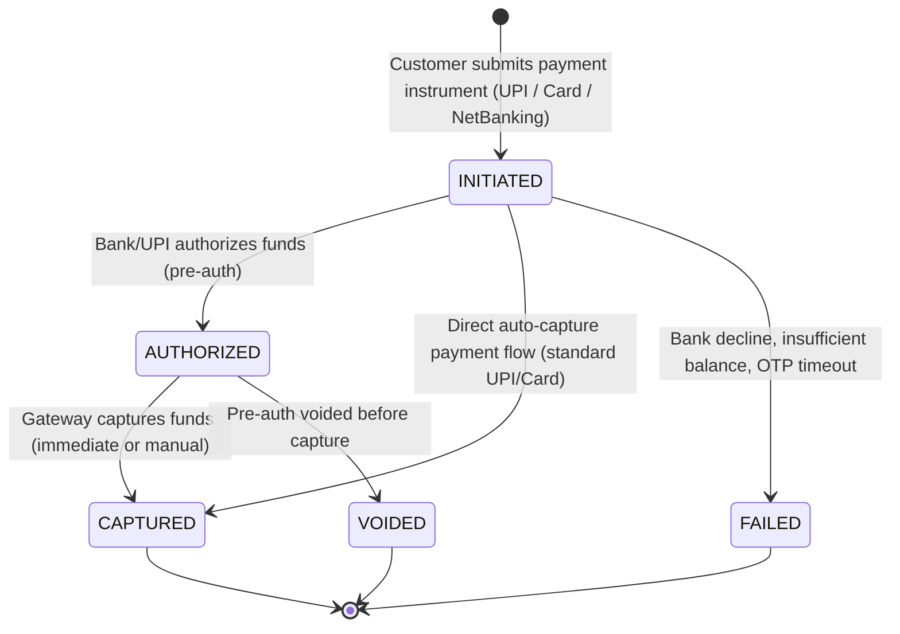
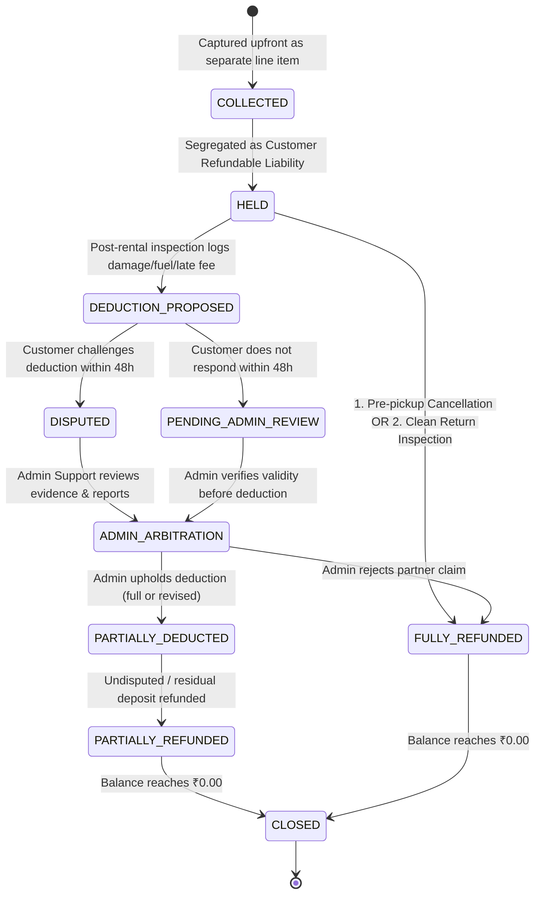
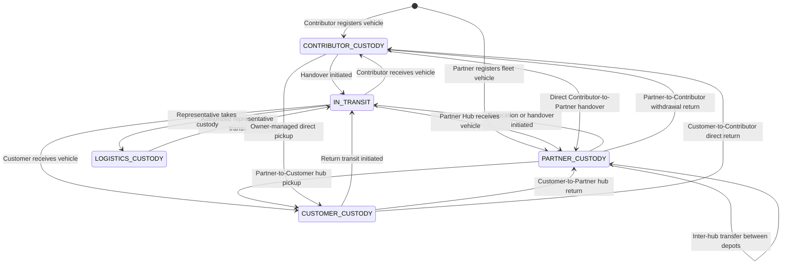
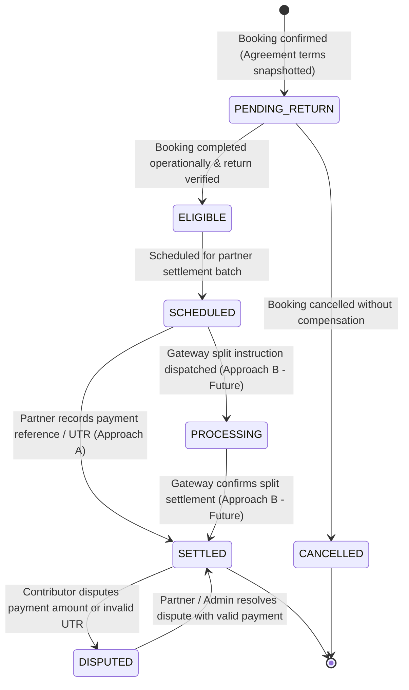
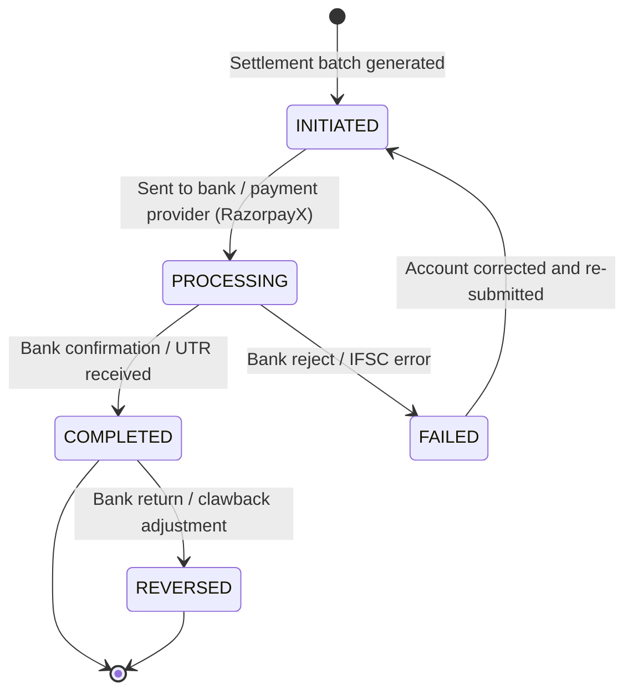

# State Machines Specification: Operational & Financial Decoupling

**Project:** Vehicle Rental Platform  
**Market:** Vijayawada, Andhra Pradesh  
**Status:** Pre-Freeze Corrected Specification  
**Critical Principle:** **Operational completion is strictly decoupled from financial settlement.** A booking reaches operational completion (`COMPLETED`) when the vehicle is returned and inspected, regardless of whether deposit refunds, damage disputes, or partner/contributor settlements remain pending, disputed, or failed.

---

## 1. Booking Hold State Machine (Independent Reservation Lock)

A booking hold is a temporary slot reservation. **Creating a booking hold does NOT create an incomplete or draft record in the `bookings` table.** The `bookings` master table only receives confirmed bookings resulting from successful payment transactions.

### Transition Specifications:

| From Status | To Status | Allowed Actor | Trigger / Condition | Concurrency & Database Actions | Failure Handling |
|---|---|---|---|---|---|
| `[*]` | `ACTIVE` | `CUSTOMER` | Customer clicks "Proceed to Checkout" | `SELECT id FROM vehicles WHERE id = :id FOR UPDATE;` checks for overlapping holds/bookings/buffers. Inserts into `booking_holds` with `expires_at = NOW() + 15 MIN`. | Returns `409 Conflict` if vehicle is already locked or booked for the interval. |
| `ACTIVE` | `CONVERTED` | `SYSTEM` (Webhook) | Payment gateway webhook confirms successful capture before `expires_at` | Transitions `booking_holds.status = CONVERTED`. Inserts new record into `bookings` (`booking_status = CONFIRMED`). | Transactional; rollback if booking insertion fails. |
| `ACTIVE` | `EXPIRED` | `SYSTEM` (Scheduler) | Background task runs: `NOW() > expires_at` | Marks `booking_holds.status = EXPIRED`. Vehicle slot becomes immediately available for other customers. | Handled safely if late payment webhook arrives (see Section 3). |
| `ACTIVE` | `RELEASED` | `CUSTOMER` | Customer clicks "Cancel Checkout" or abandons session | Marks `booking_holds.status = RELEASED`. Frees vehicle calendar immediately. | Graceful release without calendar blocking. |

---

## 2. Booking Operational State Machine

The master booking lifecycle represents the physical rental contract. It is created directly in `CONFIRMED` upon hold conversion.

### Transition Specifications:

| From Status | To Status | Allowed Actor | Trigger / Condition | Side Effects & Auditing |
|---|---|---|---|---|
| `[*]` | `CONFIRMED` | `SYSTEM` | Webhook verifies payment order capture | Creates `bookings` record; records `booking_status_events`; enqueues confirmation notification via transactional outbox. |
| `CONFIRMED` | `READY_FOR_PICKUP` | `RENTAL_PARTNER` / `VEHICLE_CONTRIBUTOR` | Vehicle cleaned, staged at hub/pickup point, and pre-rental inspection prepared | Sets `bookings.booking_status = READY_FOR_PICKUP`; customer notified that vehicle is ready for pickup. |
| `CONFIRMED` | `CANCELLED` | `CUSTOMER` / `PARTNER` / `ADMIN` | Cancellation request prior to pickup | Enqueues refund processing under cancellation policy; frees vehicle calendar; marks booking `CANCELLED`. |
| `READY_FOR_PICKUP` | `IN_PROGRESS` | `PARTNER` / `CONTRIBUTOR` + `CUSTOMER` | Dual inspection OTP/signatures submitted | Generates `inspections` (PRE_RENTAL_PICKUP); logs `vehicle_custody_events` (`CUSTOMER_CUSTODY`). |
| `READY_FOR_PICKUP` | `NO_SHOW` | `RENTAL_PARTNER` | Customer fails to arrive within 2 hours of start time | Marks booking `NO_SHOW`; rental fee retained per policy; 100% deposit refunded; frees vehicle calendar. |
| `IN_PROGRESS` | `OVERDUE` | `SYSTEM` (Scheduled) | Current time exceeds `ends_at` + 30-min grace period without approved extension | Marks booking `OVERDUE`; alerts partner and support team; applies hourly late penalty rates. |
| `IN_PROGRESS` / `OVERDUE` | `RETURNED` | `PARTNER` / `CONTRIBUTOR` + `CUSTOMER` | Vehicle returned and return inspection signed | Generates return `inspections`; logs `vehicle_custody_events` (`PARTNER_CUSTODY` or `CONTRIBUTOR_CUSTODY`). |
| `RETURNED` | `COMPLETED` | `RENTAL_PARTNER` / `SYSTEM` | Operational handover confirmed | Sets `bookings.booking_status = COMPLETED`. Triggers contributor payable eligibility. **Does NOT depend on deposit refund or partner settlement.** |

---

## 3. Payment Order & Payment Transaction Lifecycles

Payment gateways distinguish between the high-level payment order and the individual transaction/attempt.

### A. Payment Order Lifecycle (`payment_orders`)

### B. Payment Transaction/Attempt Lifecycle (`payment_transactions`)

### Handling Delayed Successful Payment Webhooks:
When a payment webhook arrives:
1. Verify signature against webhook secret and check `payment_webhook_events` for idempotency (`provider_event_id`). If already processed, return `200 OK` immediately.
2. Check the associated `booking_holds` record:
   - **Case 1: Hold is `ACTIVE`:** Convert hold to `CONVERTED`, insert `bookings` record in `CONFIRMED` status.
   - **Case 2: Hold has `EXPIRED` or `RELEASED`:**
     - Query vehicle calendar with `SELECT ... FOR UPDATE`:
       - If the requested interval is **still completely available**, recover gracefully: reactivate hold, insert `bookings` in `CONFIRMED` status, and notify customer.
       - If the interval has been **reserved by another customer** or blocked: **Automatically trigger a 100% gateway refund** (`refunds` record created, outbox event enqueued), log a high-priority incident, and notify the customer that their payment was refunded due to checkout expiration.

---

## 4. Refund State Machine (`refunds`)

Every outward refund (cancellation, deposit release, dispute resolution, or delayed webhook auto-refund) is tracked independently with full retry and reconciliation support.

```mermaid
stateDiagram-v2
    [*] --> INITIATED: Refund request created with unique idempotency key
    INITIATED --> PROCESSING: Outward API request dispatched to Gateway
    PROCESSING --> SUCCEEDED: Gateway webhook / sync confirms refund settled
    PROCESSING --> FAILED: Gateway returns error (insufficient balance, network)
    
    FAILED --> RETRY_QUEUED: Transient failure; scheduled for backoff retry
    RETRY_QUEUED --> PROCESSING: Outbox retries dispatch
    FAILED --> MANUAL_REVIEW: Permanent gateway decline; escalates to finance
    MANUAL_REVIEW --> PROCESSING: Finance resolves with gateway and retries
    
    SUCCEEDED --> [*]
```

| State | Description & Behavior |
|---|---|
| `INITIATED` | Refund entity created. Idempotency key generated. Outbox event created. |
| `PROCESSING` | HTTP request sent to Razorpay Refund API (`/v1/payments/{id}/refund`). |
| `SUCCEEDED` | Razorpay webhook `refund.processed` received and verified. Double-entry ledger debits `REFUND_PAYABLE` and credits `GATEWAY_CLEARING`. |
| `FAILED` | Gateway returns failure code. Recorded in `failure_reason`. |
| `RETRY_QUEUED` | Exponential backoff job picks up failed refund if error is transient. |
| `MANUAL_REVIEW` | Non-transient errors (e.g., account frozen, bank reject) alert Finance Admin for manual NEFT/RTGS resolution and UTR recording. |

---

## 5. Security Deposit & Dispute Resolution State Machine (`security_deposits`)

Security deposits are refundable liabilities. **A disputed damage claim is NEVER automatically approved merely because a time window expires.**

### Detailed Review and Resolution Process for Deposit Deductions:

1. **Deduction Proposal:** When a post-rental inspection reports damage, fuel deficit, or excess mileage, the partner submits a `deposit_deductions` claim with mandatory photos, odometer evidence, and repair estimates. The deposit transitions to `DEDUCTION_PROPOSED`.
2. **Immediate Release of Undisputed Balance:** If the deposit is ₹5,000 and the partner claims ₹1,500, the uncontested ₹3,500 is **immediately refunded** to the customer via the refund pipeline. Only the contested ₹1,500 remains in `HELD`.
3. **48-Hour Customer Window:** The customer is notified and has 48 hours to either:
   - Accept the deduction.
   - Dispute the deduction by uploading counter-photos or commentary.
4. **Resolution when Disputed:**
   - The status transitions to `DISPUTED` and enters `ADMIN_ARBITRATION`.
   - **No funds are deducted automatically.**
   - An Admin Support agent reviews pre-rental vs post-rental inspection media, GPS logs, and partner repair quotes.
   - Admin makes a formal determination: upholds deduction, reduces deduction amount, or rejects partner claim entirely.
5. **Resolution when Customer is Unresponsive (48h Expired):**
   - The claim does **not** auto-approve. It transitions to `PENDING_ADMIN_REVIEW`.
   - An Admin checks that the partner submitted valid, unedited photographic evidence matching pre-rental records. Upon admin verification, the deduction is confirmed (`PARTIALLY_DEDUCTED`) and transferred to the partner. Any residual balance is refunded to the customer.

---

## 6. Vehicle Custody State Machine (Generic & Ownership-Independent)

Physical vehicle custody is modeled **independently of vehicle legal ownership and booking status**.

### Initial Custody Rules:
- **Partner-Owned Vehicles (`PARTNER_OWNED`):** Begin in `PARTNER_CUSTODY` upon verification and hub assignment.
- **Contributor-Owned Vehicles (`CONTRIBUTOR_OWNED`):** Begin in `CONTRIBUTOR_CUSTODY` upon registration, or transition to `PARTNER_CUSTODY` upon agreement commencement and physical delivery to a partner hub.

### The 8 Canonical Custody Permutations (`vehicle_custody_events`):

| # | Permutation Code | Description & Context | Supported Handover Mode |
|---|---|---|---|
| 1 | `CONTRIBUTOR_TO_PARTNER` | Contributor hands vehicle to partner hub upon agreement commencement. | Partner-managed onboarding |
| 2 | `PARTNER_TO_CUSTOMER` | Customer picks up vehicle at partner hub or depot. | Partner-managed rental pickup |
| 3 | `CONTRIBUTOR_TO_CUSTOMER` | Customer picks up vehicle directly from contributor's registered location. | Owner-managed direct pickup |
| 4 | `CUSTOMER_TO_PARTNER` | Customer returns vehicle to partner hub upon rental completion. | Partner-managed rental return |
| 5 | `CUSTOMER_TO_CONTRIBUTOR` | Customer returns vehicle directly to contributor's location. | Owner-managed direct return |
| 6 | `PARTNER_TO_CONTRIBUTOR` | Partner returns vehicle to contributor upon agreement termination or withdrawal. | Fleet de-fleeting handover |
| 7 | `INTER_HUB_TRANSFER` | Partner relocates vehicle between two operational depots in the city. | Internal fleet rebalancing |
| 8 | `LOGISTICS_RELOCATION` | Authorized representative/logistics driver handles doorstep delivery or recovery. | Authorized representative handover |

---

## 7. Contributor Payable & Settlement Lifecycles

### A. Contributor Payable Lifecycle (`contributor_payables`)
Tracks the partner's contractual obligation to the contributor. **The rental partner is the sole contractual debtor.**

### B. Partner Settlement Lifecycle (`settlements`)
Tracks outward platform disbursements to rental partners for net rental proceeds.

