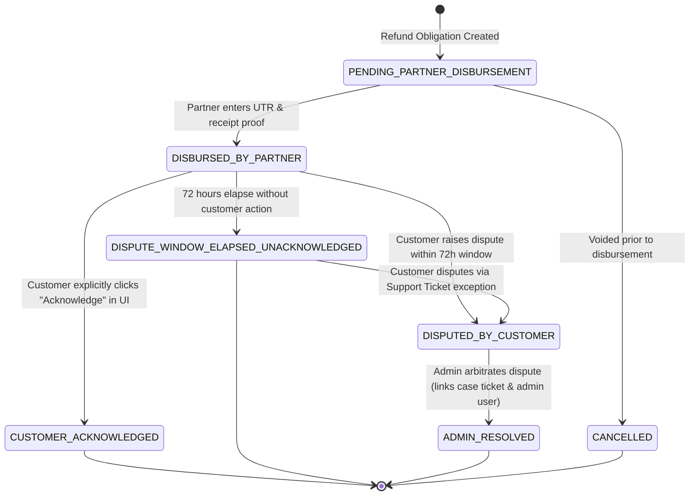
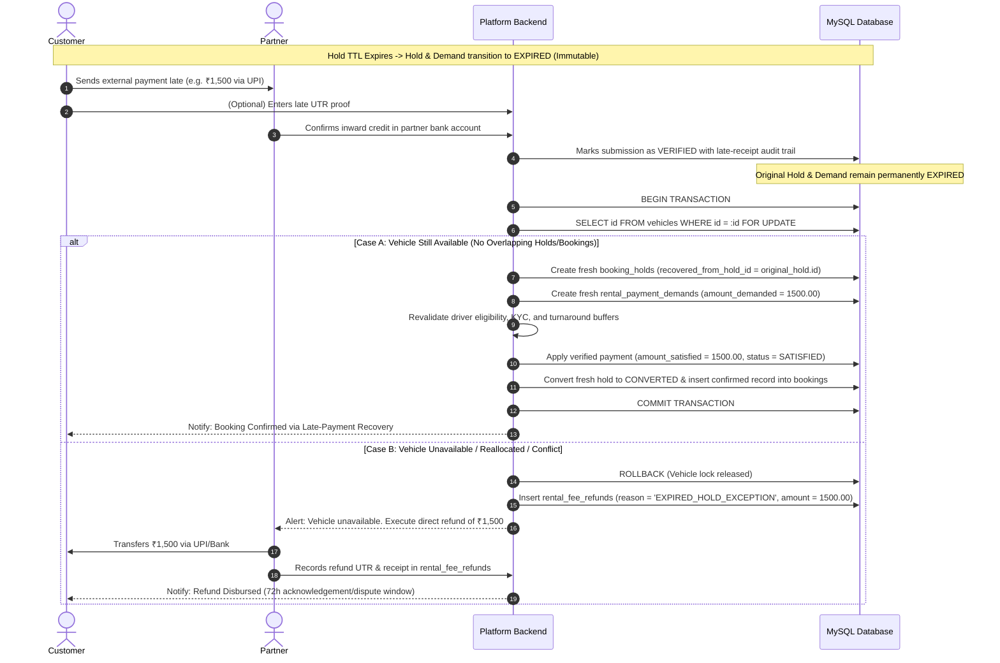

# Final Architecture Review & Four-Issue Patch Report: Partner-Direct Payment Model

**Project:** Vehicle Rental Platform  
**Market:** Vijayawada, Andhra Pradesh (Expandable)  
**Lead Roles:** Lead Software Architect & Database Architect  
**Technology Stack:** React + Vite, Tailwind CSS, Spring Boot, Spring Security, MySQL 8.0+, JWT + BCrypt  
**Status:** **Architectural Patch Applied — Reconciled Candidate Baseline (Partner-Direct Payment Model)**  
**Physical Table Baseline:** **48 Physical MySQL Tables for MVP** (46 Application-Domain Tables + 2 Infrastructure-Managed Tables) + **8 Future-Phase Tables** (56 Total Cataloged Entities)  
**Governing Document Set:**  
1. [README.md](../README.md)  
2. [docs/PROJECT_CONSTITUTION.md](PROJECT_CONSTITUTION.md)  
3. [docs/BUSINESS_REQUIREMENTS.md](BUSINESS_REQUIREMENTS.md)  
4. [docs/ARCHITECTURE.md](ARCHITECTURE.md)  
5. [docs/ARCHITECTURE_DECISIONS.md](ARCHITECTURE_DECISIONS.md)  
6. [docs/FINAL_ENTITY_INVENTORY.md](FINAL_ENTITY_INVENTORY.md)  
7. [docs/ENTITY_RELATIONSHIPS.md](ENTITY_RELATIONSHIPS.md)  
8. [docs/STATE_MACHINES.md](STATE_MACHINES.md)  
9. [docs/FINANCIAL_ARCHITECTURE.md](FINANCIAL_ARCHITECTURE.md)  
10. [docs/ROLE_PERMISSION_MATRIX.md](ROLE_PERMISSION_MATRIX.md)  
11. [docs/DATABASE_DESIGN.md](DATABASE_DESIGN.md)  
12. [docs/API_MODULES.md](API_MODULES.md)  
13. [docs/SECURITY.md](SECURITY.md)  
14. [docs/PAGES_AND_ROUTES.md](PAGES_AND_ROUTES.md)  
15. [docs/DEVELOPMENT_WORKFLOW.md](DEVELOPMENT_WORKFLOW.md)  

---

## 1. Exact Four Corrections Made

This architectural patch executes four surgical corrections to the Partner-Direct Payment Architecture without redesigning the platform, altering the partner-direct model, or generating application code:

### Correction 1: Correct Refund Acknowledgement Semantics
- **Identified Defect:** The previous refund state machine conflated expiry of the 72-hour dispute window with customer confirmation by transitioning to `CONFIRMED_BY_CUSTOMER`.
- **Architectural Correction:** 
  - Eliminated the semantic falsehood that timeout equals customer confirmation.
  - Implemented distinct states: `PENDING_PARTNER_DISBURSEMENT`, `DISBURSED_BY_PARTNER`, `CUSTOMER_ACKNOWLEDGED`, `DISPUTED_BY_CUSTOMER`, `DISPUTE_WINDOW_ELAPSED_UNACKNOWLEDGED`, and `ADMIN_RESOLVED`.
  - Enforced the invariant that **an explicit customer UI action is the ONLY event that establishes customer-confirmed receipt (`CUSTOMER_ACKNOWLEDGED`)**.
  - Expiry of the 72-hour dispute window transitions the refund strictly to `DISPUTE_WINDOW_ELAPSED_UNACKNOWLEDGED`.
  - Mandated that disputed refunds (`DISPUTED_BY_CUSTOMER`) be arbitrated by an authorized Admin (`ADMIN_RESOLVED`), capturing the deciding Admin user FK, dispute case FK, resolution notes, and timestamp.
  - Applied this distinction identically to both rental-fee refunds (`rental_fee_refunds`) and security-deposit refunds (`security_deposit_refunds`).

### Correction 2: Correct Late Payment After Hold Expiry
- **Identified Defect:** The previous specification lacked an immutable recovery flow for payments arriving after hold expiration and risked dirty reads or reopening expired holds and demands.
- **Architectural Correction:**
  - Established that original booking holds (`booking_holds`) and payment demands (`rental_payment_demands`) become **permanently immutable in their terminal `EXPIRED` state**. They are never silently reopened or transitioned back to `SATISFIED`.
  - Defined the strict 7-step recovery process:
    1. Managing partner confirms that external funds actually arrived in their bank/UPI account.
    2. System records the payment submission as `VERIFIED` with an immutable audit trail documenting late receipt against an expired demand. The expired demand remains `EXPIRED`.
    3. System checks vehicle availability under pessimistic row lock (`SELECT id FROM vehicles WHERE id = :vehicleId FOR UPDATE;`).
    4. **Case A (Vehicle Available):** System creates a fresh `booking_holds` record explicitly linked to the expired hold via `recovered_from_hold_id = original_expired_hold.id` and creates a fresh `rental_payment_demands` obligation. Revalidates all booking conditions, driver eligibility, and turnaround buffers.
    5. Applies the previously verified payment amount to the new valid obligation (`amount_satisfied = verified_amount`, status = `SATISFIED`) without duplicating the underlying transaction or submission. Transitions fresh hold to `CONVERTED` and creates confirmed booking in `bookings`.
    6. **Case B (Vehicle Unavailable / Conflict):** If the vehicle was reallocated or blocked, creates a `rental_fee_refunds` obligation with `refund_reason = 'EXPIRED_HOLD_EXCEPTION'` for the full verified amount.
    7. Partner executes the direct external refund to the customer and records proof in the platform.

### Correction 3: Correct Overpayment Accounting and Aggregate Refund Limits
- **Identified Defect:** The previous design allowed `rental_payment_demands.amount_satisfied` to record ₹1,800 against a ₹1,500 demand, distorting obligation satisfaction, and relied on a row-level CHECK constraint that could not prevent cumulative multi-row refund overruns.
- **Architectural Correction:**
  - Standardized exact overpayment fields on `rental_payment_demands`:
    - `amount_demanded`: ₹1,500.00 (the contractual price obligation).
    - `total_verified_submitted`: ₹1,800.00 (aggregate sum of all verified inbound submissions).
    - `amount_satisfied`: ₹1,500.00 (**strictly capped at `amount_demanded`**; never stores ₹1,800 as satisfying a ₹1,500 debt).
    - `excess_amount`: ₹300.00 (triggers automated refund obligation in `rental_fee_refunds` under reason `OVERPAYMENT_RETURN`).
  - Implemented transactional aggregate refund limit validation:
    - Demonstrated that a row-level `CHECK (refund_amount <= gross_amount_paid)` constraint is structurally incapable of enforcing aggregate balance limits across multiple refund rows (e.g., an overpayment return followed by a booking cancellation refund).
    - Enforced transactional locking: every refund creation executes inside a transaction that locks the parent demand exclusively (`SELECT id, amount_satisfied FROM rental_payment_demands WHERE id = :demandId FOR UPDATE;`), sums all active uncancelled refunds (`refund_status != 'CANCELLED'`), computes `remaining_refundable_balance`, and rejects any new refund exceeding that balance.
    - Documented that canceled or voided refund records (`refund_status = 'CANCELLED'`) do not decrement the refundable pool, restoring the available balance.

### Correction 4: Correct Arbitration Foreign Keys
- **Identified Defect:** `rental_fee_refunds.admin_arbitration_id` referenced `users.id`, which identified an individual user rather than an arbitration case.
- **Architectural Correction:**
  - Completely separated the support/dispute case reference from the deciding Admin user across `rental_fee_refunds`, `deposit_deductions`, and `security_deposit_refunds`:
    - `dispute_ticket_id`: Foreign key referencing `support_tickets(id)` ON DELETE SET NULL, utilizing the existing MVP Table 43 (`support_tickets`) without inventing redundant case tables.
    - `resolved_by_admin_user_id`: Foreign key referencing `users(id)` ON DELETE SET NULL, explicitly naming the authorized administrative user who adjudicated the dispute.
    - `resolution_notes`: `VARCHAR(1000) NULL` recording administrative findings and evidence review.
    - `resolved_at`: `DATETIME NULL` recording the official determination timestamp.
  - Eliminated the ambiguous `admin_arbitration_id` column completely.

---

## 2. Updated Refund State Machines

Both rental-fee refunds (`rental_fee_refunds`) and security-deposit refunds (`security_deposit_refunds`) are governed by identical, decoupled state machines:



### 2.1 State Definitions & Transition Triggers:
1. `PENDING_PARTNER_DISBURSEMENT`:
   - **Meaning:** Refund obligation has been calculated and registered by the platform (e.g. from pre-pickup cancellation, overpayment return, expired-hold late payment, or deposit reconciliation). Partner owes funds directly to the customer.
   - **Allowed Transitions:** $\rightarrow$ `DISBURSED_BY_PARTNER`, $\rightarrow$ `CANCELLED`.
2. `DISBURSED_BY_PARTNER`:
   - **Meaning:** Partner has executed the external UPI/bank transfer outside the platform and submitted the transaction reference (UTR) and payment receipt screenshot.
   - **Partner UTR Non-Equivalence Invariant:** Entry of a UTR by the partner does **NOT** indicate receipt by customer. It initiates the 72-hour customer confirmation/dispute window.
   - **Allowed Transitions:** $\rightarrow$ `CUSTOMER_ACKNOWLEDGED`, $\rightarrow$ `DISPUTE_WINDOW_ELAPSED_UNACKNOWLEDGED`, $\rightarrow$ `DISPUTED_BY_CUSTOMER`.
3. `CUSTOMER_ACKNOWLEDGED`:
   - **Meaning:** Customer has explicitly logged in and clicked "Acknowledge Receipt" in the web application.
   - **Strict Invariant:** **This is the ONLY event and state that establishes customer-confirmed receipt.**
   - **Terminal State:** Yes.
4. `DISPUTED_BY_CUSTOMER`:
   - **Meaning:** Customer reported non-receipt of funds or incorrect amount within 72 hours of disbursement. Automatically creates or links to a support dispute ticket (`support_tickets`).
   - **Allowed Transitions:** $\rightarrow$ `ADMIN_RESOLVED`.
5. `DISPUTE_WINDOW_ELAPSED_UNACKNOWLEDGED`:
   - **Meaning:** 72 hours elapsed from disbursement timestamp (`disbursed_at`) without explicit customer acknowledgement and without a dispute being opened.
   - **Strict Invariant:** **Expiry of the dispute window must NEVER be represented as customer acknowledgement.** It records an unconfirmed, uncontested disbursement.
   - **Allowed Transitions:** May transition to `DISPUTED_BY_CUSTOMER` upon Admin-approved support ticket escalation.
6. `ADMIN_RESOLVED`:
   - **Meaning:** An authorized Admin adjudicated the dispute after reviewing bank statement proof, customer claims, and partner evidence.
   - **Relational Integrity:** Strictly records `dispute_ticket_id` ($\rightarrow$ `support_tickets.id`), `resolved_by_admin_user_id` ($\rightarrow$ `users.id`), `resolution_notes`, and `resolved_at`.
   - **Terminal State:** Yes.
7. `CANCELLED`:
   - **Meaning:** The refund obligation was voided (e.g. customer withdrew cancellation request or disputed booking was reinstated).
   - **Balance Effect:** Restores the refundable balance in aggregate validation.
   - **Terminal State:** Yes.

---

## 3. Updated Late-Payment Recovery Flow



### 3.1 Step-by-Step Recovery Specification:
1. **Hold & Demand Expiration:** When `expires_at` passes without sufficient verified payment, `booking_holds.status` transitions to `EXPIRED` and `rental_payment_demands.status` transitions to `EXPIRED`. Both records become **immutable terminal records**.
2. **External Payment Arrival:** The customer completes an external payment after expiration. The partner discovers the credit in their bank/UPI app.
3. **Verified Submission Audit:** The partner records or verifies the submission. The platform marks `rental_payment_submissions.submission_status = 'VERIFIED'` and appends an audit record. The expired demand is **NEVER reopened or transitioned back to `SATISFIED`**.
4. **Availability Verification Under Row Lock:** The system initiates a recovery transaction and acquires an exclusive pessimistic row lock:
   ```sql
   SELECT id FROM vehicles WHERE id = :vehicleId FOR UPDATE;
   ```
5. **Branching Determination:**
   - **Case A — Vehicle Available:**
     - Inserts a new `booking_holds` row with `recovered_from_hold_id = :expiredHoldId`.
     - Inserts a new `rental_payment_demands` row for the new hold.
     - Revalidates driver licence validity, customer verification status, and turnaround buffers.
     - Applies the previously verified submission amount to the new demand (`amount_satisfied = :verifiedAmount`, `status = 'SATISFIED'`) without duplicating the underlying payment.
     - Transitions fresh hold to `CONVERTED` and creates the confirmed booking in `bookings`.
   - **Case B — Vehicle Unavailable (Conflict or Reallocated):**
     - Booking cannot be safely fulfilled.
     - System creates an immediate refund obligation in `rental_fee_refunds` with `refund_reason = 'EXPIRED_HOLD_EXCEPTION'`, linking `hold_id = :expiredHoldId` and `demand_id = :expiredDemandId`.
     - Partner transfers funds back to customer and enters UTR proof.

---

## 4. Corrected Overpayment Example and Aggregate Refund Validation

### 4.1 Concrete Overpayment Example:
A customer initiates checkout for a vehicle rental requiring ₹1,500.00. The customer accidentally transfers ₹1,800.00 via UPI.

#### Database Representation in `rental_payment_demands`:
| Field | Value | Architectural Meaning |
|---|---|---|
| `amount_demanded` | `1500.00` | The contractual price obligation demanded for the booking. |
| `total_verified_submitted` | `1800.00` | The cumulative total of all verified inbound customer submissions. |
| `amount_satisfied` | `1500.00` | **Strictly capped at `amount_demanded`.** Under no circumstances is ₹1,800 recorded as satisfying a ₹1,500 obligation. |
| `excess_amount` | `300.00` | The verified overpayment amount owed back to the customer. |
| `status` | `SATISFIED` | The obligation is fully satisfied; booking confirmation invariant evaluates to true. |

#### Automated Overpayment Refund in `rental_fee_refunds`:
- `refund_reference`: `RFR-20261101-OVP01`
- `demand_id`: Linked to the parent demand.
- `booking_id`: Linked to the confirmed booking.
- `refund_reason`: `OVERPAYMENT_RETURN`
- `gross_amount_paid`: `1800.00`
- `cancellation_fee_deducted`: `0.00`
- `refund_amount`: `300.00`
- `refund_status`: `PENDING_PARTNER_DISBURSEMENT`

### 4.2 Why a Row-Level CHECK Constraint is Insufficient:
A row-level CHECK constraint such as:
```sql
CONSTRAINT chk_refund_amount CHECK (refund_amount <= gross_amount_paid)
```
evaluates only the single row being inserted or updated. It is **blind to other refund rows referencing the same payment demand**.

*Failure Scenario without Aggregate Checking:*
1. Customer pays ₹1,800 against ₹1,500 demand (`gross_amount_paid = 1800.00`).
2. Refund 1 created: Overpayment refund of ₹300.00 (`refund_amount = 300.00 <= 1800.00` $\rightarrow$ **CHECK passes**).
3. Booking is cancelled 2 hours later. Refund 2 created: Full cancellation refund of ₹1,800.00 (`refund_amount = 1800.00 <= 1800.00` $\rightarrow$ **CHECK passes**).
4. **Catastrophic Deficit:** Partner executes both refunds, disbursing ₹2,100.00 to the customer on an ₹1,800.00 payment.

### 4.3 Transactional Aggregate Refund Limit Algorithm:
All refund obligation creations MUST execute within an exclusive database transaction enforcing pessimistic locking and aggregate summation:

```sql
-- Step 1: Acquire exclusive row lock on the parent payment demand
SELECT id, amount_demanded, total_verified_submitted, amount_satisfied 
FROM rental_payment_demands 
WHERE id = :demandId 
FOR UPDATE;

-- Step 2: Calculate cumulative active refunds (ignoring cancelled records)
SELECT COALESCE(SUM(refund_amount), 0.00) AS cumulative_refunded
FROM rental_fee_refunds 
WHERE demand_id = :demandId 
  AND refund_status != 'CANCELLED';

-- Step 3: Determine gross refundable pool and remaining refundable balance
-- gross_refundable_pool = total_verified_submitted; (e.g. ₹1,800.00)
-- remaining_refundable = gross_refundable_pool - cumulative_refunded;

-- Step 4: Validate proposed refund amount
-- IF :newRefundAmount > remaining_refundable THEN
--     ROLLBACK TRANSACTION;
--     THROW BusinessValidationException("Refund amount exceeds remaining refundable balance");
-- ELSE
--     INSERT INTO rental_fee_refunds (...);
--     COMMIT TRANSACTION;
-- END IF;
```

#### Effect of Canceled or Failed Refund Records:
If a refund is voided prior to disbursement (`refund_status = 'CANCELLED'`), its `refund_amount` is explicitly filtered out by `WHERE refund_status != 'CANCELLED'`. This immediately restores the available refundable balance without requiring artificial negative adjustment entries.

---

## 5. Corrected Arbitration Foreign Keys

The previous design used `admin_arbitration_id BIGINT UNSIGNED NULL REFERENCES users(id)` in `rental_fee_refunds`, which conflated the arbitration case with the user who decided it.

### 5.1 Updated Relational Schema for Arbitration:
The schema now cleanly separates the support/dispute case ticket from the deciding administrative user across all dispute-enabled tables:

```sql
-- Applied to: rental_fee_refunds, deposit_deductions, security_deposit_refunds

dispute_ticket_id BIGINT UNSIGNED NULL,
resolved_by_admin_user_id BIGINT UNSIGNED NULL,
resolution_notes VARCHAR(1000) NULL,
resolved_at DATETIME NULL,

CONSTRAINT fk_refunds_dispute_ticket 
    FOREIGN KEY (dispute_ticket_id) REFERENCES support_tickets(id) ON DELETE SET NULL,
CONSTRAINT fk_refunds_resolved_admin 
    FOREIGN KEY (resolved_by_admin_user_id) REFERENCES users(id) ON DELETE SET NULL
```

### 5.2 Table Comparison Across Dispute Domains:
| Table Name | Support / Dispute Case Reference | Deciding Admin User Reference | Resolution Audit Notes | Resolution Timestamp |
|---|---|---|---|---|
| `rental_fee_refunds` | `dispute_ticket_id` $\rightarrow$ `support_tickets.id` | `resolved_by_admin_user_id` $\rightarrow$ `users.id` | `resolution_notes` VARCHAR(1000) | `resolved_at` DATETIME |
| `deposit_deductions` | `dispute_ticket_id` $\rightarrow$ `support_tickets.id` | `resolved_by_admin_user_id` $\rightarrow$ `users.id` | `resolution_notes` VARCHAR(1000) | `resolved_at` DATETIME |
| `security_deposit_refunds`| `dispute_ticket_id` $\rightarrow$ `support_tickets.id` | `resolved_by_admin_user_id` $\rightarrow$ `users.id` | `resolution_notes` VARCHAR(1000) | `resolved_at` DATETIME |

No redundant tables were invented. The existing Module 8 Table 43 (`support_tickets`) serves as the official dispute case entity.

---

## 6. Documents Modified

All 14 core architecture and design documents have been updated and synchronized with 100% consistency:

1. [docs/STATE_MACHINES.md](STATE_MACHINES.md):
   - Updated Demand state machine (Section 3.3) for overpayment fields (`total_verified_submitted`, `amount_satisfied` capped at demand, `excess_amount`).
   - Added late-payment recovery lifecycle (Section 3.4) with immutable expired records and fresh hold allocation (`recovered_from_hold_id`).
   - Added Section 3.5: Transactional Aggregate Refund Limit Validation algorithm under `SELECT FOR UPDATE`.
   - Updated Rental-Fee Refund State Machine (Section 4) with states: `PENDING_PARTNER_DISBURSEMENT`, `DISBURSED_BY_PARTNER`, `CUSTOMER_ACKNOWLEDGED`, `DISPUTED_BY_CUSTOMER`, `DISPUTE_WINDOW_ELAPSED_UNACKNOWLEDGED`, `ADMIN_RESOLVED`, Mermaid diagram, and arbitration FKs.
   - Updated Security Deposit Refund State Machine (Section 5) with identical states and dispute arbitration FKs.
2. [docs/DATABASE_DESIGN.md](DATABASE_DESIGN.md):
   - Table 26 (`booking_holds`): Added `recovered_from_hold_id` (FK $\rightarrow$ `booking_holds.id` self-referential nullable).
   - Table 34 (`rental_payment_demands`): Added `total_verified_submitted` and `excess_amount`; documented strict cap on `amount_satisfied`.
   - Table 36 (`rental_fee_refunds`): Updated `refund_status` enum; replaced `admin_arbitration_id` with `dispute_ticket_id`, `resolved_by_admin_user_id`, `resolution_notes`, and `resolved_at`.
   - Table 38 (`deposit_deductions`): Replaced `admin_arbitration_id` with `dispute_ticket_id`, `resolved_by_admin_user_id`, `resolution_notes`, and `resolved_at`.
   - Table 39 (`security_deposit_refunds`): Updated `refund_status` enum; replaced `admin_arbitration_id` with `dispute_ticket_id`, `resolved_by_admin_user_id`, `resolution_notes`, and `resolved_at`.
3. [docs/FINAL_ENTITY_INVENTORY.md](FINAL_ENTITY_INVENTORY.md):
   - Updated Table 26 (`booking_holds`), Table 34 (`rental_payment_demands`), Table 36 (`rental_fee_refunds`), Table 38 (`deposit_deductions`), and Table 39 (`security_deposit_refunds`) descriptions and columns.
4. [docs/ENTITY_RELATIONSHIPS.md](ENTITY_RELATIONSHIPS.md):
   - Updated Mermaid ERD with `booking_holds ||--o{ booking_holds : "recovers_from"`, `support_tickets ||--o{ rental_fee_refunds : "arbitrates_case (dispute_ticket_id)"`, `support_tickets ||--o{ deposit_deductions`, `support_tickets ||--o{ security_deposit_refunds`, and `resolved_by_admin` links.
   - Updated Referential Integrity Matrix for Tables 26, 36, 38, 39, and 43.
5. [docs/PROJECT_CONSTITUTION.md](PROJECT_CONSTITUTION.md):
   - Section 3.2: Added overpayment accounting invariants, aggregate refund limit validation under pessimistic row locks, and late-payment recovery flow with immutable terminal records.
   - Section 3.3: Corrected refund acknowledgement semantics (`CUSTOMER_ACKNOWLEDGED` vs `DISPUTE_WINDOW_ELAPSED_UNACKNOWLEDGED`) and arbitration foreign key requirements.
6. [docs/BUSINESS_REQUIREMENTS.md](BUSINESS_REQUIREMENTS.md):
   - Section 5.5: Updated diagram and text with separate acknowledgement states, late-payment recovery workflow (Case A fresh hold under lock vs Case B refund), overpayment accounting rules, and aggregate refund check.
7. [docs/ARCHITECTURE.md](ARCHITECTURE.md):
   - Section 5.2: Documented hold isolation, decoupled payment verification, overpayment accounting, transactional aggregate refund limits, and late-payment recovery flow.
   - Section 6.3: Documented separate refund acknowledgement states and dispute arbitration FKs.
8. [docs/ARCHITECTURE_DECISIONS.md](ARCHITECTURE_DECISIONS.md):
   - ADR-013: Clarified 72h dispute window non-equivalence with customer confirmation.
   - ADR-018: Updated points 4, 6, 7, and 8 with overpayment accounting fields, aggregate refund validation under lock, late payment recovery via fresh hold, separate refund acknowledgement states, and arbitration FKs.
9. [docs/FINANCIAL_ARCHITECTURE.md](FINANCIAL_ARCHITECTURE.md):
   - Section 1.1: Updated responsibility matrix for rental refund execution and dispute arbitration.
   - Section 2.2: Documented overpayment accounting fields on `rental_payment_demands`.
   - Section 2.3: Documented late payment handling on expired demands without reopening.
   - Section 2.4: Documented `rental_fee_refunds` state machine, arbitration FKs, and transactional aggregate refund validation.
   - Section 2.6 & 2.7: Documented arbitration case separation for deposit deductions and refunds.
   - Section 5.3: Updated Partner UTR Non-Equivalence Invariant.
10. [docs/ROLE_PERMISSION_MATRIX.md](ROLE_PERMISSION_MATRIX.md):
    - Table 1: Clarified customer explicit acknowledgement (`CUSTOMER_ACKNOWLEDGED`), dispute creation (`DISPUTED_BY_CUSTOMER`), and admin arbitration (`ADMIN_RESOLVED` linking case ticket & admin user).
    - Section 2.3: Clarified that customer explicit action is the sole trigger for `CUSTOMER_ACKNOWLEDGED`.
    - Section 3.G: Updated `@rentalRefundSecurity` evaluator details.
11. [docs/API_MODULES.md](API_MODULES.md):
    - Section 8: Added `/booking-holds/{holdId}/recover-late-payment` endpoint; updated refund endpoints for explicit acknowledgement, dispute ticket creation, and administrative resolution recording case and admin IDs.
12. [docs/SECURITY.md](SECURITY.md):
    - Section 4: Added transactional aggregate refund limit validation (`SELECT ... FOR UPDATE`), overpayment cap enforcement, late payment immutable recovery, and dispute ticket audit trail.
13. [docs/PAGES_AND_ROUTES.md](PAGES_AND_ROUTES.md):
    - Section 2: Updated `/customer/refunds` route notes for explicit UI acknowledgement and dispute flow.
14. [README.md](../README.md):
    - Section 4: Refined customer and admin role capabilities regarding refund acknowledgement and support-ticket-linked dispute arbitration.

---

## 7. Resulting Table-Count Changes

- **Structural Changes:** No new tables were created or deleted. The corrections were accomplished entirely through field-level additions and foreign key realignments:
  - Added `booking_holds.recovered_from_hold_id` (self-referential FK $\rightarrow$ `booking_holds.id`).
  - Added `rental_payment_demands.total_verified_submitted` and `rental_payment_demands.excess_amount`.
  - Replaced `admin_arbitration_id` with `dispute_ticket_id` (FK $\rightarrow$ `support_tickets.id`), `resolved_by_admin_user_id` (FK $\rightarrow$ `users.id`), `resolution_notes`, and `resolved_at` across `rental_fee_refunds`, `deposit_deductions`, and `security_deposit_refunds`.
- **MVP Application-Domain Tables:** Exactly **46 tables**.
- **Infrastructure-Managed Tables:** Exactly **2 tables** (`shedlock`, `flyway_schema_history`).
- **Total MVP Physical MySQL Tables:** Exactly **48 tables (Preserved 100%)**.
- **Future-Phase Tables:** Exactly **8 tables** (Marketplace Payment Gateway Integration).
- **Total Cataloged Entities:** Exactly **56 tables**.

---

## 8. Remaining Unresolved Decisions

The following items are business and commercial policies requiring formal Product Owner / Business Stakeholder sign-off prior to production deployment:

1. **Cancellation Fee Tier Schedule:** Sign off on the exact default cancellation penalty tiers (e.g., >24h: 100% refund; 12-24h: 50% refund; <12h: 0% refund).
2. **Payment Verification Window Duration:** Final sign-off on the default verification window (recommended: 60 minutes) during which a booking hold is held in `VERIFICATION_PENDING`.
3. **Deposit Dispute Response Window:** Confirmation of the 48-hour customer window for responding to proposed deposit deductions.
4. **Platform Monetization Model:** Formal commercial selection of partner software billing mechanism (e.g. monthly subscription fee or listing fee).
5. **External Validation Gates:** Completion of pre-launch legal review (contract terms), tax review (GST classification), and partner commercial vehicle insurance verification.

---

## 9. Confirmation of Zero Application Code Generation

**Explicit Architect Confirmation:**
- **Zero application code has been generated.**
- No Java source files, Spring Boot components, Spring Security configurations, JPA entities, or repository interfaces were created or modified.
- No React components, JSX/TSX files, CSS stylesheets, or frontend routes were created or modified.
- No Flyway SQL migration scripts or database DDL files were generated or executed against any database.
- No unit, integration, or end-to-end tests were generated.
- All modifications are strictly documentation-only architectural corrections within the repository markdown documents.
